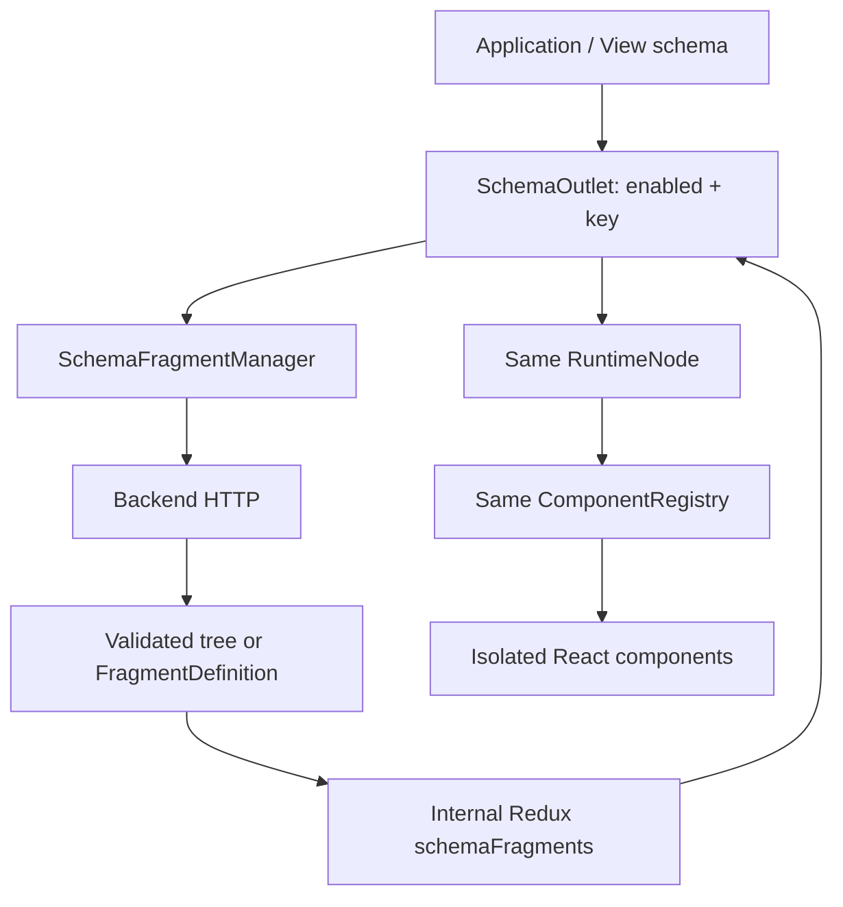

# Dynamic Schema Loading

The initial application and view JSON describe the insertion points, not their eventual contents. The loader accepts legacy ComponentDefinition trees or self-contained FragmentDefinition JSON over HTTP. Task 9 adds real items-panel and nested-notes FragmentDefinition endpoints. Existing object-detail endpoints retain their legacy trees; both formats use the same runtime. Those trees use the existing renderer, registry, binding engine, action engine, Redux store and isolated Fluent adapters.



## Layers and files

| Location | Responsibility |
| --- | --- |
| `src/runtime/schema/types.ts` | Source, outlet, identity key, status and fragment contracts |
| `SchemaFragmentManager.ts` | Scoped acquisition, request resolution, pending deduplication, cache, reload and cancellation |
| `schemaFragmentSlice.ts` | Serializable internal Redux state; no public binding namespace |
| `FragmentRenderBoundary.tsx` | Local adapter render-error containment and retry recovery |
| `SchemaOutlet.tsx` | Reactive activation/key selectors, loading/error/retry and delegation to RuntimeNode |
| `runtime/rendering/RuntimeNode.tsx` | Unchanged generic rendering path, with a node-definition context for infrastructure configuration |
| `runtime/shared/RuntimeScope.ts` | Owns managers and scoped lifecycle for application/view/fragment; ScopeRuntime is an export alias |
| `runtime/fragment/` | Wire contracts, normalization, FragmentRuntime composition and host |
| `runtime/rendering/RuntimeScopeHost.tsx` | Shared effect/cleanup bridge for view and fragment activation |
| `runtime/shared/RuntimeEnvironment.ts` | Owns the shared fragment repository for this application session |
| `runtime/shared/validation.ts` | Shared initial/remote tree validation against the same registry and named actions |
| `backend/routes/schema.ts`, `backend/data/ui/*.json` | Delayed HTTP endpoints and backend-only response trees |
| `playground/application-tab/FragmentInspector.tsx` | Read-only source, key, cache, status, HTTP path, tree and raw-schema tooling |

Paths in this table are relative to the project root; the four schema runtime filenames are under `src/runtime/schema/`.

## Contracts

ApplicationDefinition, ViewDefinition and FragmentDefinition may declare schemaSources:

```ts
interface SchemaSourceDefinition {
  request: {
    method?: 'GET' | 'POST'; // GET by default
    path: string;
    query?: JsonObject;
    body?: JsonValue;
  };
  load: {
    strategy: 'onDemand';
    definitionCache?: 'none' | 'scope' | 'view' | 'application'; // none by default
    // Alternatively cache: the definition-only legacy alias. Never supply both.
  };
}
```

```json
{
  "schemaSources": {
    "objectDetailsPanel": {
      "request": {
        "path": "/api/ui/object-details/$state.selectedObjectId"
      },
      "load": { "strategy": "onDemand", "cache": "view" }
    }
  },
  "root": {
    "id": "details-outlet",
    "type": "schema-outlet",
    "source": "objectDetailsPanel",
    "enabled": "$state.detailsOpened",
    "key": "$state.selectedObjectId",
    "loading": {
      "id": "details-loading",
      "type": "spinner",
      "props": { "label": "Loading panel schema…" }
    }
  }
}
```

`source` can reference the owning scope's source definitions or directly contain `{ "request": { "path": "/api/ui/details/$state.selectedObjectId" }, "cache": "view" }`. Inline sources require no schemaSources registration; they use the same loader, validation, renderer and scope lifecycle. `enabled` defaults to true and is a boolean or reactive expression. `key` defaults to null and resolves to a JSON scalar. Different scalar types remain distinct in identity. Optional `loading` and `error` are ComponentDefinition trees. Remote node ids may be omitted: normalization generates stable tree-path ids, preserves explicit ids and rejects duplicates. Initial application/view trees still require ids. SchemaOutletDefinition makes the required source explicit in TypeScript; the shared validator enforces the infrastructure configuration for JSON documents.

Requests snapshot the current state at acquisition, keeping expressions consistent with the activated key. ExpressionResolver resolves query/body recursively and supplies a generic resolvePath method for inline path expressions. Values are encoded as individual URI segments. Missing/object values produce a local error without issuing a malformed request. The scoped namespaces are `$state`/`$data` for the current scope, `$viewState`/`$viewData` for its owning view, and `$appState`/`$appData` for its application; action executions additionally expose `$event`/`$response`. Prototype traversal and unknown namespaces are rejected. Application root source requests have no owning view and cannot use view caching.

## Self-contained FragmentDefinition (Task 6)

Only type and root are required. Optional id is a definition label; every activation receives a different scopeId. state/actions/dataSources default to empty objects. Local schemaSources enable nested remote fragments. The earlier kind/schemaVersion/initialState draft is not a supported wire format.

```json
{
  "type": "fragment",
  "state": { "query": "" },
  "actions": {
    "setQuery": { "type": "state.set", "target": "query", "value": "$event.value" }
  },
  "dataSources": {
    "items": {
      "type": "api",
      "request": { "method": "GET", "path": "/api/items", "query": { "search": "$state.query" } },
      "dependsOn": ["$state.query"],
      "load": { "strategy": "onInit", "reload": "onDependencyChange" }
    }
  },
  "root": {
    "type": "stack",
    "children": [
      { "type": "text-input", "bindings": { "value": "$state.query" }, "handlers": { "onChange": { "action": "setQuery" } } },
      { "type": "generic-list", "bindings": { "items": { "source": "$data.items.data.items", "default": [] } } }
    ]
  }
}
```

FragmentRuntime validates/normalizes then composes the existing RuntimeScope, adapting state to initialState. It initializes local state and idle entries, owns local named actions and qualified dependency registrations, then starts onInit (normalized to onScopeInit) before the shared React host publishes root. ViewRuntimeHost uses that same lifecycle host. No child renders with missing scope entries; no extra Redux Provider/store is created. Ordinary children inherit the selected scope, and nested explicit fragments own descendant scopes.

Bare legacy responses normalize into a fragment-shaped wrapper marked host mode; they create no child scope and retain existing host state/actions. Cached JSON never stores a live scope. Two outlets can share one definition request while owning independent local state/data. The default lifecycle.scopeLifetime is activation: deactivation removes the local scope and reopening cached JSON creates fresh state. Opting into outlet retains the same mounted owner's state/data/registrations during deactivation, with effects still active; hidden child outlets unmount and dispose. Actual outlet unmount, source/key/request replacement and ancestor disposal always dispose owned scopes. definitionCache and its cache alias control fetched JSON only. Legacy bare trees remain host-scoped and keep their previous acquisition policy even when lifecycle is supplied.

Validation reuses the current scope/tree/registry contracts, rejects non-JSON values, unsafe paths, missing local references and cycles, and applies bounded definition/tree/nesting limits. Repeated resolved requests within their own acquisition ancestry fail locally instead of recursively expanding forever. Local render boundaries dispose failed scope trees and support retry.

Task 6 checks: typecheck, lint/architecture audit, all 314 tests across 26 files, and production build passed. The two fragment suites add 42 checks. The existing Vite chunk-size warning remains. No new manual-browser walkthrough is claimed for this task.

## Internal state and lifecycle

```ts
schemaFragments[identity] = {
  source, key, scope, owner, cache,
  status: 'loading' | 'success' | 'error',
  loading, schema, error, requestPath
}
```

This sits alongside appState, appData, viewState, viewData and fragments[scopeId].state/data. It is never placed under `$data` and has no `$schemaFragments` expression namespace. Controllers, promises, validation callbacks and consumer counts stay outside Redux.

Identity encodes the lifetime owner, declaring definition id, source id and typed key as an unambiguous JSON tuple. View identities include the ViewRuntime instance; application identities include the application session, so they survive route/view changes without leaking into a restarted application. The tuple also includes the complete source declaration and resolved request fingerprint. Changing path/query/body without changing key selects a new resource and replaces the activation. Live activation identity separately includes parent scope and outlet mount token; resource reuse never shares running scopes.

| Policy | Behavior |
| --- | --- |
| `none` | Active outlets share pending/success state; the last release removes it. The next activation reloads. |
| `scope` | Successful definitions survive activation changes until their declaring scope is disposed. |
| `view` | Successful entries survive close/reopen within the nearest owning ViewRuntime, even when acquired by a fragment; disposal clears them and aborts pending requests. |
| `application` | Successful entries survive view changes until ApplicationRuntime disposal, including view-declared sources with this policy. |

Acquisition returns a lease `{id, promise, release}`. Concurrent outlets for one identity share a pending request. A release decrements its consumer count; a microtask allows React StrictMode cleanup/reactivation to reacquire before cancellation. When no consumers remain, pending requests are aborted. A completed cache remains according to its policy. Scope/view disposal clears definitions owned by that scope/view; application disposal clears the entire repository. SchemaFragmentCache.entries holds JSON only; requests separately coordinates live leases/controllers/promises and is emptied when delivery has no consumers. A retained live scope can hold its own immutable definition even under none without making it a reusable cache entry.

AbortController is paired with repository-entry identity checks. Even a transport that ignores abort cannot commit a stale response after removal or replacement. The outlet selects only its current identity, so the previous key's tree never appears while the new key loads.

Errors stay within the unknown fragment area. A fragment-local render boundary also contains registered adapter exceptions and allows retry without replacing the shell. Invalid component types, unsafe bindings, unknown action references and inline handlers are rejected by the same validator used for initial trees. A registered error adapter supplies safe feedback and Retry content; an optional custom error tree appears alongside it. Retry calls `reload(source, key)`, bypassing cached success/error. Programmatic callers retain/release the returned lease; the outlet owns its retry lease until it deactivates. Initial acquisition supplies the registry-aware validator, which the manager retains for subsequent reloads.

## Distinctions and boundaries

- **dataSource:** data for UI whose structure is already known; DataSourceManager and DependencyGraph control its lifecycle.
- **schemaSource:** a previously unknown UI subtree; SchemaFragmentManager loads it on demand.
- **RouteOutlet:** resolves a route to a whole ViewDefinition and mounts/disposes ViewRuntime.
- **SchemaOutlet:** legacy trees use their host scope; explicit FragmentDefinition responses activate a fresh child RuntimeScope through FragmentRuntime. Both use the existing renderer/registry and the same Redux store.

React-Redux selectors drive bindings, visibility and outlet activation. The environment DependencyGraph matches scope-qualified datasource dependencies and returns { scopeId, sourceId } targets; owning managers apply load policy. Schema sources still use enabled/key activation, without dependency-graph scheduling. Neither path drives React rendering through the graph.

Business components receive props and callbacks only. NavigationGroup, PrimaryNavigation, GenericList, SidePanel, Button and returned form controls neither fetch schemas nor access Redux. The runtime contains no source-name, object-id or domain-specific branches. Backend JSON uses semantic schema types and icons, never Fluent implementation names. The registry bootstrap supplies generic spinner/error adapters as well as SchemaOutlet infrastructure.

## Demonstrations

**Application navigation (Task 8):** parent entries now come from the backend as Guardian-style link data. Static, remote and hybrid child items use the generic data-tree adapter and existing DataSourceManager, with no navigation SchemaOutlet. The former navigation-schema endpoint/fixture is removed. See [dynamic-navigation.md](dynamic-navigation.md).

**Object panel:** both readable catalog JSON files declare a generic list, named selection/open sequence and SidePanel → SchemaOutlet. They do not contain the eventual panel contents. Selection writes selectedObjectId before opening the panel → `GET /api/ui/object-details/:id`. Microsoft 365 returns a tenant form with reactive input and Save; Active Directory returns a warning, controlled tabs and Health check; Configuration returns summary cards and Review. All return generic component trees using the same registry. Closing/reopening a key reuses the view cache; changing key selects its independent tree. Form/button/tab actions execute in the owning view scope.

**Tooling:** Tab 2 adds Dynamic Fragment. Tab 1 documents RuntimeNode, RouteOutlet and SchemaOutlet separately from the business catalog. Tab 3's collapsible Runtime Inspector shows source definitions, keys, cache scope, current status, resolved HTTP path, loaded type tree and raw JSON. Architecture modal explains the distinct dynamic-schema flow. None of these tools participate in execution.

## Task 7 lifecycle verification

The migration document contains the complete lifecycle matrix. The two new suites, tests/schema-fragment-lifecycle.test.ts and tests/schema-outlet-lifecycle.test.tsx, exercise inline contracts, cache purity/ownership, none/scope/view/application crossed with activation/outlet lifetime, real remounts, independent concurrent outlets, request changes, stale cancellation, retry, disabled refresh and recursive disposal. Shared RuntimeScopeHost defers creation as well as startup until the surviving effect generation, preventing duplicate StrictMode scopes/init calls. These are real React/Fluent/Redux runtime integrations. Task 7 checks passed: typecheck; lint/architecture audit (125 source files, 14 JSON schemas); 349 tests in 28 files; production build. The existing Vite chunk-size warning remains.

## Verification

`tests/schema-fragments.test.ts` covers load/status, pending deduplication, consumer ownership, keyed/view/application/none caches, scope disposal, expression resolution, reload/error, cancellation/stale responses, unsafe fragments and contract validation. `tests/schema-outlet.test.tsx` verifies localized loading, retry, reactive activation, StrictMode and the same registry/RuntimeNode path, including a remote action updating a remote binding. `tests/schema-api.test.ts` exercises real delayed HTTP endpoints and validates all backend trees against the frontend registry and owning action definitions.

The architecture audit checks business isolation and domain-independent runtime code and now also inspects backend fragment JSON for inline handlers and Fluent-specific schema types. Existing Reports vs Users navigation/filter/datasource wiring remains unchanged.

MVP choices: no schema dependency graph targets, cache TTL/size eviction, remote ViewDefinitions, authorization or schema-version negotiation. Application/view lifecycle boundaries provide cache eviction. Legacy trees retain host action lookup. Explicit envelopes declare their own named actions with no parent fallback. Inline action handlers and separate runtime systems remain forbidden. As with initial JSON, validation checks structural contracts and registered names; arbitrary component prop semantics remain the registered adapter's contract.

## Historical demo verification before scope migration

- `npm run lint`: passed, including the architecture audit (115 source files, 14 JSON schemas including backend fragments).
- `npm run typecheck`: passed.
- `npm test -- --maxWorkers=2`: 182 tests passed across 19 files. The three new feature suites contain 25 tests; the new sample also runs through the existing document validation suite.
- `npm run build`: passed. The existing non-blocking Vite large-chunk warning remains (~996 KB minified / 289 KB gzip).
- Production-server browser walkthrough: initial navigation children absent; visible loading; loaded submenu; collapse/reopen without loading; Microsoft 365 remote form; state-backed input update; Save named action; panel close after notification; Active Directory remote warning/tabs; tab selection updates via named action; cached tenant form reopening preserves its view value.
- Inspector browser check: application navigation plus two independent object keys and their loaded trees/statuses/HTTP paths. Switching Reports to Users removes both view fragments while retaining the application navigation fragment.
- Tab 2 browser check: Dynamic Fragment validates, opens a loading panel, then renders the Configuration summary tree from HTTP. No browser console warnings/errors were reported during the final walkthrough.
- Both endpoint families are exercised over real HTTP by the API tests; the production browser uses the same fetch transport. The browser automation surface does not expose a DevTools Network table, so HTTP verification used the running application, resolved request paths and real endpoint tests.
- Manual testing also exposed and fixed a pre-existing Fluent portal CSS issue: the app's full-height background rules now exclude portal nodes, preventing a notification portal from covering controls.


## Full remote fragment demo (Task 9)

The Full Application workbench now demonstrates actual backend FragmentDefinitions rather than only legacy bare trees. Two parent outlets share a fetched definition while owning independent items/state/actions/dependencies; selecting an item loads a nested notes scope over HTTP. The object-detail form/tabs examples remain distinct legacy trees. See [full-fragment-demo.md](full-fragment-demo.md).

