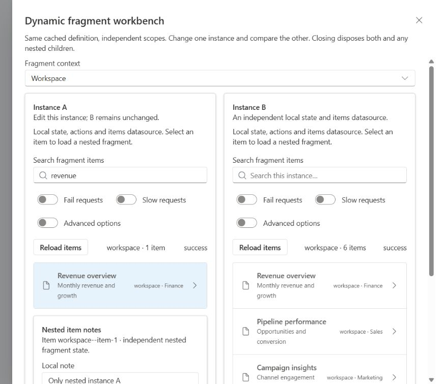
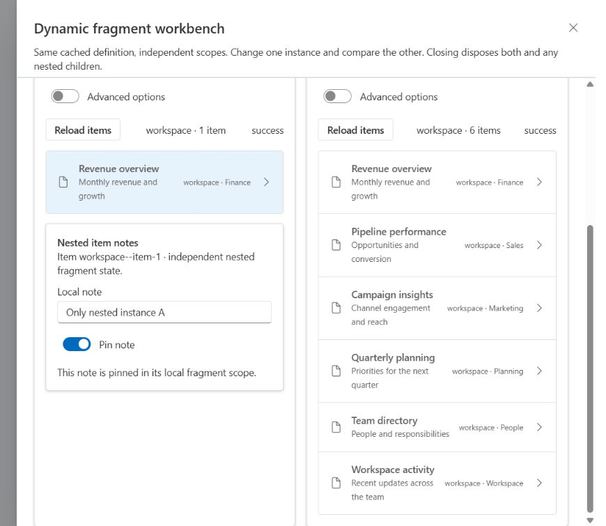

# Full dynamic fragment demo

Tab 3 now includes a schema-generated **Full dynamic fragments** launcher in both Reports Catalog and Users Catalog. Open **fragment workbench** to load two instances of one remote definition through the existing runtime. Their visible controls come entirely from backend JSON.

## Try it

1. Run `npm run dev`, open Full Application, and click **Open fragment workbench**.
2. Both Instance A and Instance B load the Workspace definition. Each initially has six items. Search for revenue in A: A shows one result; B retains six and an empty search.
3. Enable Advanced options in A. Its conditional card appears without reloading either datasource.
4. Enable Fail requests in A. Its local error/retry appears while B stays healthy. Retry repeats that request; turn failure off to recover. Reload items explicitly reloads only that instance.
5. Enable Slow requests, then change the search before the previous request finishes. The previous scoped request is cancelled; its response cannot overwrite the current results.
6. Select an item. A nested HTTP-loaded notes fragment appears with its own Local note and Pin note state/actions. Selecting the same item in B can reuse definition JSON, but its notes are independent. Selecting another item replaces the old nested scope.
7. Change Fragment context to Finance or Operations. Both parent instances and their descendants are disposed and recreated with fresh local state and contextual data.
8. Close the workbench, including while a slow request is pending. All owned fragment resources are disposed. Reopening uses cached definition JSON within that view, creates new scopeIds, and starts fresh items requests.
9. The existing Dynamic object details section still returns different component trees for Microsoft 365 (form) and Active Directory (warning/tabs). These legacy responses continue using the host view scope.

## HTTP contracts

| Endpoint | Behavior |
| --- | --- |
| GET /api/ui/fragments/items-panel/:contextId | Real FragmentDefinition with local state, items datasource, named actions, root and nested schema-outlet |
| GET /api/ui/fragments/item-note/:itemId | Nested FragmentDefinition with independent note/pinned state and actions |
| GET /api/items?contextId=...&search=...&fail=...&slow=... | Contextual data, case-insensitive search, controlled 503 failure and 1.2s slow mode |

The items response is `{ items, total, contextId, summary }`. Missing contextId preserves the existing six-item demo fixture. Workspace uses that fixture with contextual ids; Finance and Operations have their own realistic seed sets. Other well-formed contexts reuse contextualized base data. Invalid ids produce controlled JSON errors. Standard requests take about 200ms; schema requests about 250ms and nested note definitions about 200ms. Every fragment request goes through backend HTTP; no backend JSON is imported into frontend code.

## Local definition and execution

The backend items-panel template declares:

```json
{
  "type": "fragment",
  "id": "items-panel",
  "state": {
    "query": "",
    "selectedId": null,
    "failRequests": false,
    "slowRequests": false,
    "showAdvanced": false
  }
}
```

Its six named actions are setQuery, selectItem, setFailure, setSlowRequests, toggleAdvanced and reloadItems. The first five use scoped state.set; reloadItems uses datasource.reload. The items datasource declares onInit and dependsOn query/failRequests/slowRequests, with 180ms debounce for dependency changes. showAdvanced controls visibility only. The endpoint clones the JSON template and injects contextId as a request literal; it never mutates a cached/live definition and does not need a new inputs namespace.

```text
Open workbench -> parent view named state.set
 -> two SchemaOutlets -> shared HTTP definition acquisition
 -> two FragmentRuntime instances -> independent RuntimeScopes
 -> local idle state/data initialization -> local items onInit
 -> GET /api/items -> fragments[scopeId].data.items -> bindings -> RuntimeNode

Search -> generated callback -> local setQuery -> scoped Redux state.set
 -> listenerMiddleware -> DependencyGraph(A/items only)
 -> DataSourceManager debounce/cancellation -> backend -> scoped data -> UI
```

Both instances use identical definition/action/datasource ids. Their scopeIds and Redux addresses differ. The same environment/store, registries, renderer, binding/action engines, datasource manager implementation and dependency graph are reused. Runtime code is unchanged for Task 9 and contains no context/object-specific branches.

The nested source resolves the selectedId in its parent fragment:

```json
{
  "type": "schema-outlet",
  "enabled": "$state.selectedId",
  "key": "$state.selectedId",
  "source": {
    "request": { "method": "GET", "path": "/api/ui/fragments/item-note/$state.selectedId" },
    "definitionCache": "view"
  }
}
```

Definition caching and scope lifetime remain separate. Both top-level outlets have view definition caching and activation lifetime. SidePanel actually unmounts children on close, so every owned scope is disposed regardless of cached JSON. Parent/view/application disposal remains recursive. The workbench width is an optional isolated SidePanel prop; it introduces no runtime behavior.

## Files and tooling

- backend/data/ui/items-panel.json and item-note.json: readable remote schema templates, imported only by the backend.
- backend/routes/fragments.ts: HTTP schema responses with request-specific literals.
- backend/data/contextItems.ts and routes/items.ts: contextual data, search, failure and slow mode.
- src/schemas/views/reporting.catalog.json and users.catalog.json: host launch/open/close/context controls and two remote insertion points. Neither contains the remote fragment implementation.
- src/playground/schema-tab/RuntimeInspector.tsx: read-only fragment scope identities, ownership, local state and local data, alongside existing app/view namespaces. Datasource and action logs already expose scope identities.

No business component fetches schemas/data or uses Redux. All handler entries reference named actions. The existing Microsoft 365/Active Directory endpoints remain HTTP-loaded legacy trees to preserve their current behavior.

## Verification

New HTTP API tests validate the actual returned contracts and contextual data. Full Application integration tests use real Express HTTP and real Fluent/Redux/runtime rendering, covering independent search/visibility, dependency addresses, failure/retry/reload, nested editing/ownership/replacement, slow cancellation, close/disposal, context changes, JSON reuse, both view modes and view disposal. The context-replacement test also verifies disposal of an already-open nested scope and removal of its UI.

Manual browser verification on 2026-10-18 covered the workbench in Reports and Users, A/B isolation, visibility, failure/retry/recovery, replacing a slow search, nested note/pin actions, context replacement, close/reopen, and both existing object-detail trees. The automated tests verify HTTP counts, abort signals and exact scoped Redux cleanup; manual checks verify the visible flows. Validation passed: typecheck; lint/architecture audit (129 source files, 15 JSON schemas); all 389 tests in 32 files; production build. The enhanced nested-context replacement case also passed in a focused follow-up. The existing nonblocking Vite bundle-size warning remains. Manual verification included closing during a slow request and fresh local state on reopening; the final browser view reported no captured console warnings/errors.

Instance A filters independently while Instance B retains six items:



The selected item loads another independently scoped definition:


