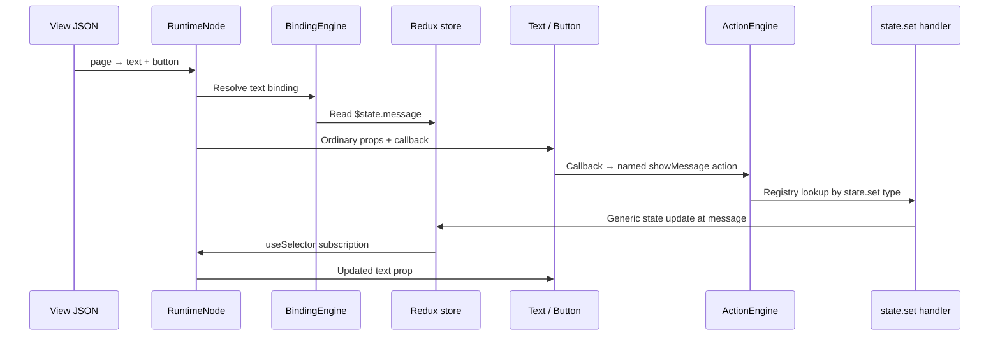

# Runtime architecture

Полная актуальная справка для авторов схем и production-host: [Architecture & Schema Reference](production/README.md). Этот документ сохраняет обзор; property/API reference и ограничения находятся в новом справочнике.

## Structure decision

Use one private npm package for this initial playground: `src/` contains the React client and `backend/` the TypeScript API. A single strict TypeScript configuration checks both. Splitting into workspace packages now would add packaging concerns without improving the architectural boundary; runtime layers are explicit modules and can become a package later.

```text
src/
  runtime/
    application/   ApplicationRuntime, ApplicationDefinition, ApplicationHost
    view/          ViewRuntime, ViewDefinition, ViewRuntimeHost
    fragment/      FragmentDefinition, normalization, FragmentRuntime facade and host
    rendering/     RuntimeNode, ComponentRegistry, ComponentBinder, component contracts
    binding/       BindingEngine, ExpressionResolver, binding contracts
    actions/       ActionEngine, ActionRegistry, action contracts, handlers/
    datasource/    DataSourceManager, DependencyGraph, datasource contracts, transport
    redux/         createRuntimeStore, app/view slices, fragments slice, changedPaths, lifecycle guards, listeners
    routing/       RouteOutlet, ViewSchemaLoader, RouteDefinition
    shared/        RuntimeScope, RuntimeEnvironment, shared contracts, diagnostics, validation
  components/
    primitive/     Button, TextInput, SearchInput, Select, Switch, Checkbox, Text, Title
    layout/        Card, Stack, Row, Page, PageHeader, SplitLayout, SidePanel
    navigation/    GenericNavigation, GenericList
    reporting/     ReportCard
    users/         UserCard
  schemas/
    application/   Minimal application definition
    views/         Text/button definition and playground/ form, visibility, datasource, layout samples
  playground/
    components-tab/   Shared component catalog, metadata, fixtures, previews
    schema-tab/       JSON editor, runtime preview, error boundary, optional inspector
    application-tab/  Schema-generated application host and inspector
backend/
  routes/          Health and sample-data endpoints
  data/            Small demo fixture
```

No second runtime is introduced. Generic infrastructure is grouped into these layers. The Components tab exposes the shared UI library. Reports Catalog and Users Catalog use this library and the same runtime infrastructure. See [component-catalog.md](component-catalog.md) for its contracts and preview boundary.

## Contracts

- `ApplicationDefinition`: application state, data/action definitions, schema shell, routes, and view definitions.
- `ViewDefinition`: view state, data/action definitions, and a component tree.
- `FragmentDefinition`: remote `type: "fragment"` plus `root`; optional `id`, `state`, local dataSources/actions/schemaSources. Node ids and empty dictionaries normalize before activation.
- `ComponentDefinition`: `id`, `type`, static `props`, reactive `bindings`, `visibility`, named `handlers`, and `children`.
- `BindingDefinition`: safe namespace expression and an optional JSON default; shorthand expression bindings are also supported.
- `HandlerDefinition`: only an action ID; handlers cannot embed action definitions.
- `ActionDefinition`: a discriminated union of generic action types.
- `DataSourceDefinition`: request, dependencies, and lifecycle policy, never loaded records.
- `RouteDefinition`: a path and a view ID loaded through `ViewSchemaLoader`.

Schema values are JSON serializable. Namespace expressions have a TypeScript template-literal contract. Runtime validation remains necessary for imported JSON; TypeScript cannot validate dynamic JSON or infer each registry component's complete prop contract. The registry is the single deliberate type-erasure boundary between JSON and React props.

## Vertical slice

The Schema Playground tab parses and validates editable JSON, then renders its ViewDefinition through the production runtime path:



Text, Button, and Page do not import Redux, schemas, contexts, action engines, or datasource managers. The button has no component-local state. A named action in JSON changes `message`; the text binding observes the new Redux value. No EventDispatcher, EventBindingResolver, or component-specific runtime hooks are used.

## Scopes and lifecycle

ApplicationRuntime, ViewRuntime and programmatic fragment scopes share RuntimeScope. Each has a generated scopeId, parent and owning application/view handles. One Redux store contains appState/appData, viewState/viewData, fragments[scopeId].state/data, internal instance guards and schemaFragments. Fragment siblings may use identical definition ids, state names, datasource ids and named actions without sharing local state. ScopeRuntime remains a compatibility export alias.

| Namespace | Resolution with RuntimeScope context |
| --- | --- |
| `$state` / `$data` | Current scope: application slices, owning view slices, or the addressed fragment entry |
| `$viewState` / `$viewData` | Owning view; undefined for application scopes and application-owned fragments |
| `$appState` / `$appData` | Owning application |
| `$event` / `$response` | Current action payload / API response |

ExpressionResolver accepts `{ state, scope, event?, response? }` and reads the supplied snapshot, preserving own-property/path protections and safe missing/null resolution. A stale scope cannot read its replacement's state. Runtime-owned calls always pass scope; legacy unscoped calls retain the old view projection. Application `$state` is now application-local, as requested by Task 3; bundled shell schemas already use explicit app namespaces.

BindingEngine.createSelector(bindings, scope, visibility?) creates the node's selector. RuntimeNode memoizes it, subscribes through useSelector/shallowEqual, and propagates RuntimeContext unchanged to ordinary children. A selector keeps its previous result when selected prop values/visibility do not change. Missing/null paths use the original literal schema default; array/object defaults keep stable references, and false/zero/empty-string values are preserved. Visibility uses the same scoped resolver and reacts through React-Redux, independently of DependencyGraph. Business components receive ordinary props and callbacks, with no Redux/runtime hooks.

Constructors initialize cloned state and independent idle datasource entries; start() triggers initialization loads once. dispose() recursively removes descendants, unregisters resources, clears timers and aborts scope/API/datasource requests before removing local Redux state. Instance guards reject stale writes. View disposal preserves application-owned state/fragments; application disposal removes its complete hierarchy. Schema definition caching is independent of these lifetimes. FragmentRuntime composes RuntimeScope and activates remote envelopes through the shared RuntimeScopeHost used by views. It initializes state/idle data before starting init policies and publishing RuntimeNode. Default deactivation/remount creates fresh scopes independently of definition caching; explicit outlet retention remains future work; see [runtime-scope-migration.md](runtime-scope-migration.md).

RouteOutlet loads only the matched view through ViewSchemaLoader. A changed pathname or view definition creates a new ViewRuntime, including parameter changes and routes that reuse a definition. The application shell remains mounted. Query-string/hash-only navigation retains the current view. ViewSchemaLoader supports legacy bundled definitions and remote acquire by browser pathname through application.viewSource. HTTP JSON is validated before the same ViewRuntimeHost activates it. Pending leases handle deduplication/cancellation, errors stay in the outlet, and Retry starts a new generation. See [remote View routing](production/remote-view-routing.md).

The playground session owns a small app scope across all three top-level tabs. The Schema Playground tab renders one ViewRuntime, replaced when a changed valid definition is applied and disposed when leaving the tab. Invalid drafts preserve the last valid view. See [schema-playground.md](schema-playground.md). The Full Application tab hosts a separate ApplicationRuntime for the Reports Catalog. Its application header, primary navigation, route outlet, view composition, and behavior come from JSON. Its viewSource resolves navigation hrefs through GET /api/ui/views?path=...; the running View is loaded over HTTP, while author fixtures remain available to playground comparison tooling. See [full-application.md](full-application.md).

## Dependency reactions

There are two independent reactions to a Redux update:

```text
Rendering:   Redux → react-redux subscription → useSelector
                   → BindingEngine selector → RuntimeNode → isolated component

Side effects: Redux → listenerMiddleware → scope-qualified changed paths
                   → DependencyGraph → DataSourceManager → API transport
```

Listener middleware compares app/view generations and their state/data plus each fragment entry using Redux unchanged-branch references. It emits { scopeId, area: "state" | "data", path: [...] }; arrays and replacement boundaries are atomic. Scope initialization/disposal emits root addresses for that generation. Internal schema metadata is excluded. A fragment state.set at query emits { scopeId: A, area: "state", path: ["query"] }. A state.patch emits all changed paths in one observer call; no-op/stale actions emit none.

RuntimeEnvironment owns one DependencyGraph with targets { scopeId, sourceId } and scope-qualified state/data paths. Namespace addressing uses the same pure helper as ExpressionResolver. $state/$data refer to the owner; explicit view/app namespaces refer to ancestor ids. The graph matches scope, area and parent/child path segments, deduplicates affected composite targets and atomically rejects qualified datasource cycles. The environment routes results only to affected managers. Each manager owns a removable registration handle; parent disposal recursively removes descendant edges. A/query -> A/items is independent from B/query -> B/items even when both schemas use identical names.

Each DataSourceManager is bound to one RuntimeScope and resolves requests using that owner. It checks that a matched dependency value actually changed in the supplied snapshots, then applies the source's reload policy. This avoids reloading an unchanged leaf after its parent object was replaced. `strategy` controls initial loading; `reload` independently controls dependency changes. A manual initial-load strategy can still opt into automatic dependency reloads. An omitted/manual reload policy requires an explicit reload.

```json
{
  "reports": {
    "type": "api",
    "request": {
      "method": "GET",
      "path": "/api/items",
      "query": { "module": "$state.filters.module" }
    },
    "dependsOn": ["$state.filters.module", "$state.filters.query"],
    "load": {
      "strategy": "onViewInit",
      "reload": "onDependencyChange",
      "debounceMs": 200
    }
  }
}
```

`load.debounceMs` is a finite, nonnegative delay (default 0). Each source has its own trailing timer. Further relevant changes reset that timer; unrelated/no-op updates do not. When the timer fires, request expressions resolve against the latest store state. Multiple matching paths from one patch schedule only one reload per source.

A dependency change aborts obsolete in-flight work immediately, including during the debounce wait. An explicit `load`/`reload` bypasses debounce and clears the pending timer. Invalidation and disposal clear timers and abort requests. AbortController is paired with request-controller identity and scope-activity checks so transports that ignore cancellation cannot commit stale success/error results. Loading and error states preserve previous data; invalidation returns the entry to idle with null data.

Visibility remains a BindingEngine selector value. It never subscribes to DependencyGraph. Missing/null binding paths resolve safely and use stable schema defaults, preserving false, zero, and empty-string values. ExpressionResolver only reads own properties, rejects unsafe/empty path segments, and does not evaluate JavaScript.

The Datasource playground sample now registers an API datasource backed by /api/items, while the other samples prove form bindings, named actions, visibility, and nested composition. The Full Application tab adds Reports Catalog and Users Catalog with JSON-defined navigation relationships. See [architecture-proof.md](architecture-proof.md).

## Generic action handlers

ComponentBinder supplies execute(name, { event, scope }) with the RuntimeNode's current RuntimeScope. The scope-owned ActionEngine validates that context belongs to its owner, finds the named action in scope.actionDefinitions, reads its generic type, obtains the handler from the shared ActionRegistry, and passes a ScopedExecutionContext to that handler. Named ids and generic types are separate dictionaries. The engine never searches parent/sibling scopes or treats a generic type as an implicit named action. Passing another scope is rejected; omitted scope defaults to the owner for existing callers.

Binder supplies ordinary callback props and catches rejected executions for diagnostics/notifications. Static props and bindings are merged by RuntimeNode; reusable components never receive runtime services. State targets must be relative paths such as query or filters.query. $state.query/$viewState.query are read expressions, not write addresses, and are rejected as targets. A fragment state.set/state.patch/API response target addresses only fragments[scopeId].state, leaving its host and siblings intact.

| Type | Behavior |
| --- | --- |
| `state.set` | Resolve the value and update a dotted path in the owning state scope |
| `state.patch` | Resolve values and shallow-merge the state root or target object |
| `api.request` | Resolve request expressions, pass a scope cancellation signal, optionally store the response in a state target, and execute named success/error actions |
| `datasource.reload` | Load a named datasource immediately |
| `datasource.invalidate` | Cancel pending work and restore a named datasource to idle |
| `navigate` | Resolve a destination and call the router service |
| `notification.show` | Resolve message/tone and call the notification service |
| `sequence` | Execute named actions in order, sharing event/response context and reading current Redux state at each step |

Each root execution copies the caller context into a private chain. Nested sequence and API onSuccess/onError calls share scope, event and the latest response within that chain; independent calls do not overwrite responses from other chains even if they reuse the same input object. API success-action failures propagate as action errors; they do not run the HTTP error callback. Scope cancellation/activity checks prevent late API writes and later sequence steps after disposal. Duplicate action/data ids in application, view and fragment scopes remain independent. Handlers never embed inline action definitions.

## Infrastructure verification

`tests/fragment-runtime.test.ts` and `tests/fragment-runtime-react.test.tsx` cover envelope normalization, local initialization/data/actions, real rendering, independent cached activations, nested sources, cleanup, StrictMode and local errors. `tests/scoped-datasources.test.ts` covers composite identities, scoped listener paths, sibling reload isolation, ancestor reads, cycle rollback, debounce, cancellation and cleanup. `tests/scoped-actions.test.ts` covers scope-bound named lookup, mutation isolation, explicit binder callbacks, target rejection, nested/concurrent continuations and generic handlers. `tests/scope-bindings.test.ts` and `tests/scope-bindings-react.test.tsx` cover scoped namespaces, independent fragment selectors, stable defaults, inherited scope, generated callbacks, ancestor/local visibility, and render isolation. `tests/runtime-scope.test.ts` covers shared scope lifecycle and cleanup. `tests/runtime-infrastructure.test.ts` covers safe expressions/defaults, visibility, changed paths, dependency matching/deduplication, debounce policy, cancellation during debounce, timer cleanup, datasource data dependencies, scoped actions/data, and registry/binder failures. `tests/runtime.test.ts` covers every generic handler and lifecycle behavior. React integration tests prove selector isolation, real named-action rendering, shell persistence, and route replacement (including a shared parameterized view). Playground tests verify the same reusable components and runtime from editable JSON. Architecture tests keep business components free of Redux/runtime/API access and domain wiring out of infrastructure.

## Backend and deferred scope

Express exposes `/api/health`, `/api/demo-message`, `/api/items`, and the six reporting endpoints documented in [full-application.md](full-application.md). API fixtures, routes, and startup are separate from React components and runtime wiring. The production server can serve `dist/`; Vite proxies `/api` in development.

The Reports Catalog now exercises application/view wiring and all six reporting APIs. Users Catalog adds GET /api/users and demonstrates schema rewiring with the same navigation component. Deferred: persistence, authentication, external report execution, and connected AI services. The editable Schema Playground includes a backend datasource sample. The component catalog is implemented using the shared registry components. Isolated React adapters use Fluent UI through the shared ComponentRegistry. There are no domain-specific runtime mappings.

## Dynamic Schema Loading

Application, view and fragment definitions can declare schemaSources. SchemaOutlet validates and normalizes either a legacy ComponentDefinition (host scope) or explicit FragmentDefinition (new child scope), then delegates to the same RuntimeNode and ComponentRegistry. FragmentRuntime owns no independent rendering/binding/action/dependency system. SchemaFragmentManager handles HTTP, deduplication, cache and cancellation; an internal Redux slice stores fragment status and schema without exposing a fifth expression namespace. See [dynamic-schema-loading.md](dynamic-schema-loading.md) for the contracts, lifecycle, demos and verification.


### Inline sources and recursive lifecycle (Task 7)

SchemaOutlet also accepts an inline source containing request and cache/definitionCache. No schemaSources registration is required. Resource identity captures the cache owner, source declaration, typed key and resolved request; activation identity additionally includes the parent and mounted outlet. Definition caching is JSON-only and separate from live request coordination and scope ownership.

Definition policies are none, scope, view and application. lifecycle.scopeLifetime defaults to activation; outlet explicitly retains the same mounted scope during deactivation while its effects remain active. Its hidden subtree unmounts, so child outlets dispose. Actual outlet unmount, source/key/request replacement and parent disposal end scope ownership regardless of definition caching. Existing bare remote trees stay host-scoped. The same RuntimeScopeHost/FragmentRuntime, RuntimeNode, BindingEngine, ActionEngine, DataSourceManager and DependencyGraph implement nested fragments; business adapters remain isolated.

### Guardian navigation data (Task 8)

The application binds backend parent navigation data to a generic data-tree adapter whose target component is supplied in JSON. Node-local childrenSource requests (or Guardian childLinksSourceUrl aliases) load data through the existing scoped DataSourceManager. Pure runtime functions combine static/remote children, deduplicate by id and apply childrenOrders; PrimaryNavigation receives prepared props and emits controlled callbacks only. The application JSON contains no recovery-specific node/actions/source. Navigation is data for known UI; SchemaOutlet remains for unknown component structure. See [dynamic-navigation.md](dynamic-navigation.md).

### Full fragment demo (Task 9)

Both catalog view schemas host two HTTP SchemaOutlets in a schema-generated workbench. The backend items-panel definition owns query/selection/failure/slow/visibility state, named actions and a scoped onInit items datasource. Selection loads a nested notes FragmentDefinition. Concurrent instances share cached JSON, while Redux state/data, actions, dependencies and lifecycle ownership remain scope-local. No runtime implementation changes or object-specific branches were needed. See [full-fragment-demo.md](full-fragment-demo.md).

### Runtime Inspector and final audit (Task 10)

Playground inspection reads the live scope registry, scoped Redux addresses and actual DependencyGraph registrations. ScopeOrigin is optional observational activation metadata: definition caching and runtime lifetime remain independent, and cached JSON never contains that metadata or a live scope. Scope detail panels show local state, resource definitions/status/results, named actions and qualified dependencies.

Action handlers report already-resolved values; datasource request snapshots and schema acquisition/cache events have separate identities and log streams. Runtime execution never consumes diagnostic history. The live tooling dialog (Ctrl+Alt+I) can inspect an active schema drawer and restores its invoking focus after Fluent's exit motion. It introduces no Redux Provider/store or business component hook. See [runtime-final-audit.md](runtime-final-audit.md) for all 13 invariants, command results, browser evidence and limitations.
