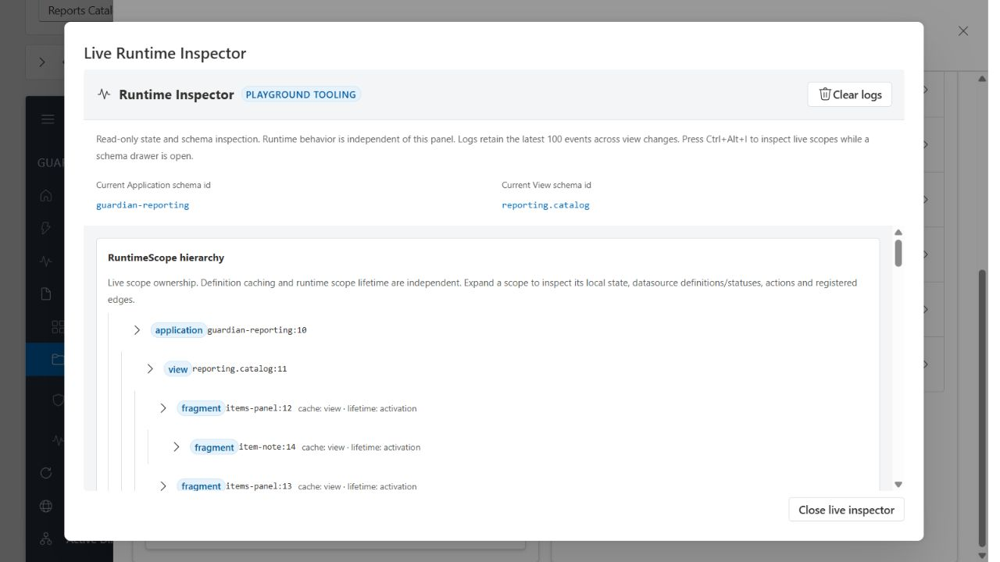

# Runtime Inspector and final architecture audit

Date: 2026-10-18. Task 10 extends the existing runtime's diagnostics and playground tooling. It introduces no second renderer, action system, dependency system or fragment store.

## Delivered behavior

Tab 3 retains its collapsible inline inspector and adds **Inspect live scopes · Ctrl+Alt+I**. The shortcut also works while a schema-generated modal drawer is active. Closing the tooling dialog restores focus to the invoking control after Fluent's exit motion; fragment state and registrations remain alive.

The compact ownership tree shows all live scope identities and indentation together. Expand any scope for its definition id, parent, independent definition-cache/scope-lifetime policy, cache owner, source/key/request, local state, datasource definitions/results/status/loading/error, local named actions and actual registered dependency edges. Application and view ids come from live scope definitions rather than parsing instance strings. Inline navigation data resources appear under their owning scope.

Three separate logs show:

- **Actions:** full scope identity, named action id, generic type, execution phase, target and resolved value. State handlers retain their actual mutation values. Other generic handlers report values they already resolved: request/response, destination, message, datasource name or sequence action ids. Diagnostics never execute expressions a second time.
- **Datasource lifecycle:** full scope/source identity, resolved request, dependency changes/debounce and loading/success/error/cancellation. Controller identity and scope activity still reject stale results.
- **Schema loading:** requesting scope, source/key, definition cache policy/owner, resolved definition request and loading/success/error/cancellation/cacheHit. A cache hit is explicitly distinguished from HTTP. Shared consumers do not generate duplicate HTTP loading events.

Definition resources/loaded trees remain a separate collapsible section. Cached JSON is distinct from the live ownership tree. Closing a fragment may leave reusable definition JSON while removing its scope, state/data and graph registrations.

## Architecture decisions

1. **One store per application environment.** Application, view and every nested fragment use the existing environment store. The surrounding playground/editor sandbox and Full Application demo remain independent environments, as required by the migration plan. This is not a claim of one global store across independent demos.
2. **Observational activation metadata.** Optional ScopeOrigin records the outlet's definitionCache, scopeLifetime, cacheOwner, source, key and requestPath. FragmentRuntime copies/freezes it. It never controls runtime lifetime, enters cached definitions or becomes a business prop. Programmatic scopes truthfully report no outlet acquisition policy.
3. **Existing registries are authoritative.** Inspector models read environment.listScopes(), scope resource definitions, scoped Redux addresses and DependencyGraph.registrations(). There is no tooling-owned shadow lifecycle/graph.
4. **Separate resource telemetry.** Schema acquisition metadata is distinct from datasource identity. Request origin and cache owner are separate fields. A shared schema request records its initiating scope; each activated outlet still appears as an independent scope.
5. **Existing runtime paths remain authoritative.** Instrumentation uses already-resolved values and snapshots diagnostics. Business execution never reads diagnostic history, inspector state, DOM or ScopeOrigin.

## Invariant verification

These are code/test findings within the current MVP scope, not a production certification.

| # | Invariant | Implementation evidence | Verification evidence |
| --- | --- | --- | --- |
| 1 | One Redux store in the application hierarchy | RuntimeEnvironment owns createRuntimeStore; RuntimeScope/FragmentRuntime reuse it; RuntimeScopeHost adds no Provider | runtime-scope, fragment-runtime-react and scope-inspector tests assert shared store/independent entries. AST audit rejects extra runtime store creation/Redux Providers. |
| 2 | $state/$data address the current scope | ExpressionResolver → scopeAddress.resolveScopePath/readScopedPath; explicit owning view/application addresses | scope-bindings and scope-bindings-react cover all namespaces, safe unresolved paths, stable defaults and sibling isolation. |
| 3 | Named actions are scope-local | ActionEngine reads its owner's actionDefinitions and rejects cross-scope execution; ComponentBinder passes scope | scoped-actions covers duplicate names, missing parent fallback, state writes, sequences and response/error context. |
| 4 | Datasources are scope-local | Each scope's existing DataSourceManager uses { scopeId, sourceId }; fragment data has separate Redux addresses | scoped-datasources and scope-inspector cover view/A/B sources named items, request resolution and local mutations. |
| 5 | DependencyGraph is scope-aware | Canonical paths and resource targets include scopeId; listener groups affected identities by owner | scoped-datasources covers local/ancestor reads, one reload per patch, debounce, disposal and stale completion. Inspector shows actual registrations. |
| 6 | Visibility uses BindingEngine/useSelector | RuntimeNode memoizes the scope-aware BindingEngine selector and subscribes with shallowEqual | scope-bindings-react, react, schema-playground and full-application tests verify reactive visibility. |
| 7 | React rerender does not depend on the graph | RuntimeNode/BindingEngine have no DependencyGraph import; Redux subscription supplies props/visibility | Fragment advanced visibility changes make no datasource requests in dynamic-fragment-demo. Scope binding React tests exercise state-only rendering; AST audit guards rendering/binding imports. |
| 8 | Fragments contain nested fragments | SchemaOutlet → FragmentRuntimeHost → shared RuntimeScopeHost → same RuntimeNode; recursive parent disposal | fragment-runtime-react, schema-outlet-lifecycle and dynamic-fragment-demo verify nested owners, local notes and descendant cleanup. Browser shows Application → View → A → nested B and sibling C. |
| 9 | Inline outlet sources work | SchemaOutlet resolves named or inline SchemaSource through the existing manager | schema-outlet-lifecycle covers inline sources; dynamic-fragment-demo loads both levels over HTTP without top-level registration. |
| 10 | Cache/lifetime/disposal/cancellation remain independent | Pure definition cache, transient request leases/controllers, explicit outlet retention, activation identity and recursive RuntimeScope.dispose | schema-outlet-lifecycle runs none/scope/view/application × activation/outlet; schema-fragment-lifecycle covers dedup, stale responses/cache purity; scoped-datasources covers cancellation/debounce. ScopeOrigin assertions cover all eight policy combinations. |
| 11 | Navigation DATA and dynamic SCHEMA remain distinct | DataTreeRuntime merges known-UI navigation data through DataSourceManager; SchemaOutlet acquires unknown structure | tree-data/tree-navigation-react, schema-api and full-application cover static/remote/hybrid merges and backend parents. Browser checks distinct Microsoft 365/AD legacy trees. |
| 12 | Business components use props/callbacks only | src/components adapters contain no Redux/runtime/schema/API imports; GenericNavigation emits a plain value callback | architecture tests and AST audit cover hooks/imports/network calls. Catalog/Fluent tests render the same isolated implementations. |
| 13 | Runtime has no feature-specific conditions | Generic registries, types, scoped addresses and resource policies define behavior; Reports/Users relationships are JSON | AST/domain-boundary tests scan runtime. schema-rewiring preserves the application/store while switching identical navigation between report and user filters. |

The audit also rejects inline handler action definitions, EventDispatcher, EventBindingResolver, component-specific runtime hooks, domain-specific renderer/list/navigation conditions, frontend backend-schema imports and Fluent dependencies in runtime infrastructure. No forbidden shortcut was found in the audited implementation.

## Files changed in Task 10

Paths below are relative to the repository root.

| Area | Files | Purpose |
| --- | --- | --- |
| Scope metadata | src/runtime/shared/types.ts, src/runtime/shared/RuntimeScope.ts | ScopeOrigin contract and optional observational activation origin |
| Fragment bridge | src/runtime/fragment/FragmentRuntime.ts, FragmentRuntimeHost.tsx; src/runtime/schema/SchemaOutlet.tsx | Carry stable, copied activation metadata through the existing scope host |
| Resource telemetry | src/runtime/shared/json.ts; src/runtime/datasource/DataSourceManager.ts; src/runtime/schema/SchemaFragmentManager.ts, types.ts | Snapshot resolved requests, distinguish schema events/cache owner/request origin, retain request detail for cancellations |
| Action telemetry | src/runtime/actions/ActionEngine.ts; src/runtime/actions/handlers/apiRequest.ts, datasource.ts, navigate.ts, notification.ts, sequence.ts | Record already-resolved generic values, preserving existing handler execution/context |
| Inspector model/UI | src/playground/application-tab/inspectorModel.ts, ScopeHierarchy.tsx (new), DeveloperRuntimeInspector.tsx, FragmentInspector.tsx, inspector.css | Live hierarchy, explicit policies, actual registrations, full identities and three log streams |
| Playground entry/explanation | src/playground/application-tab/FullApplicationTab.tsx, ArchitectureDialog.tsx; src/playground/schema-tab/RuntimeInspector.tsx | Live tooling dialog/shortcut and focus restoration, current scoped explanation, optional suppression of duplicate fragment projection |
| Guards/tests | scripts/architecture-audit.mjs; tests/scope-inspector.test.ts (new), dynamic-fragment-demo.test.tsx, schema-outlet-lifecycle.test.tsx | Stronger boundaries, ownership/telemetry isolation, actual nested UI/focus and cache/lifetime metadata assertions |
| Documentation/evidence | README.md; docs/runtime-architecture.md, runtime-scope-migration.md, runtime-final-audit.md (new); docs/assets/runtime-scope-inspector.png (new) | Updated architecture decisions, audit, results and browser evidence |

No backend endpoint or business schema change was needed for Task 10.

## Verification results

| Check | Result |
| --- | --- |
| npm run lint | Passed: ESLint with zero warnings; AST/schema architecture audit passed for 130 source files and 15 JSON schemas |
| npm run typecheck | Passed |
| npm test -- --maxWorkers=2 | Passed: all 393 tests across 33 files, including the final focus-restoration assertion (157.50 s) |
| npm run build | Passed: TypeScript + Vite production bundle; existing chunk-size advisory remains |
| Browser walkthrough | Passed for the recorded Reports/Users, fragment, legacy-tree and inspector/focus flows |
| Configured browser E2E command | Not available: no automated real-browser harness configured |

The final production JavaScript bundle is 1,035.38 kB minified / 298.95 kB gzip. Build output is generated in dist/. Four new scope-inspector tests were added, and existing HTTP/lifecycle tests gained hierarchy, policy-metadata, log separation and focus assertions. The final full run includes all changes; earlier verification failures were corrected before this run.

The repository has no configured Playwright/Cypress/browser E2E runner, dependency or npm script. The available automated integration tests mount the real React runtime in jsdom and exercise a real Express backend over HTTP. Browser validation below is a controlled real-browser walkthrough, not a claim of an automated browser E2E suite.

## Real-browser walkthrough

Validated against the local Vite frontend and Express demo backend:

1. Reports: choose Active Directory through the shared GenericNavigation; five matching report cards appear. Action log shows selectModule/state.set/filters.module/active-directory; request log shows module=active-directory.
2. Open two workbench instances: same definition endpoint, distinct scopeIds with view definition caching and activation lifetime. Inspect the application/view/A/C hierarchy.
3. Select an item in A: the nested item-note scope appears below A. Edit its note; A/B retain separate local state. Search revenue in A produces one item while B keeps six.
4. Fail/recover A: error stays local to A; B retains its successful list. Enable slow requests, replace search and observe cancellation plus the current result.
5. Close the workbench: all fragment nodes disappear. Users mode reuses the application scope, loads twelve users, and selecting Engineering produces four cards with the users request/filter action shown in logs.
6. Open/close/reopen Users fragments: fresh scopeIds with initial state; the schema stream reports cacheHit separately from datasource HTTP.
7. Legacy object details: Microsoft 365 renders Tenant alias form controls; Active Directory renders Overview/Domains/Controllers tabs. Neither adds a fragment scope, preserving host-scoped compatibility.
8. Ctrl+Alt+I above an active workbench: hierarchy/details/logs remain accessible. Closing restores the nested note input's focus and accessibility, preserves its value and allows continued interaction. Manual Reload items records generic datasource.reload with resolved value items.
9. Browser console checked after the final nested-inspector flow: no captured errors or warnings.

The checked-in screenshot captures the hierarchy with two simultaneous parent fragments and one nested child. Automated tests establish precise HTTP deduplication counts; DOM walkthrough observations alone are not used to claim network counts.

## Remaining limitations and unresolved issues

- View state/data storage still supports one active view per environment. Parallel views, persisted/restored sessions, fragment input namespaces and pinned response formats remain deferred.
- Legacy bare ComponentDefinition responses intentionally use their host scope; they are not self-contained fragments.
- Outlet retention preserves the owner's scope/effects only while that outlet remains mounted. Hidden child outlets unmount and dispose; source/key/request replacement and parent disposal always end ownership.
- Definition caches have lifecycle ownership but no TTL/LRU size limit. Diagnostics retain only 100 events total; each UI stream displays at most 40 retained events. Logs are local demo history, not persisted tracing.
- No automated real-browser E2E harness is configured. Browser checks cover the recorded flows; unit/React/HTTP tests cover the wider lifecycle matrix.
- The production build retains the existing Vite chunk-size advisory (bundle exceeds 500 kB). No bundle-splitting work is included.
- No unresolved functional failures were observed in the final automated suite or recorded browser flows. The limitations above remain; unexercised production behavior is not claimed.
