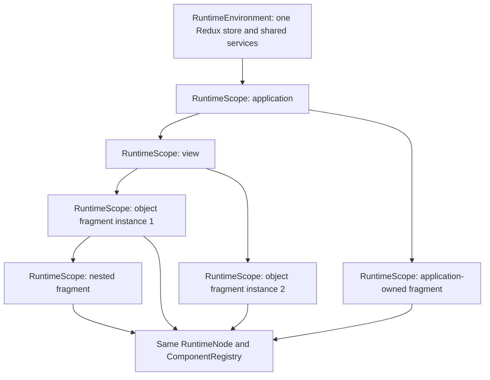

# Runtime scope migration: architecture audit and plan

Date: 2026-10-18. Status: Tasks 2-10 completed. Shared scoped infrastructure, self-contained FragmentDefinition activation, inline/named sources, separate JSON definition caching and explicit outlet retention use the existing runtime. Task 8 replaces navigation schema loading with backend navigation data and generic node-local child loading. Task 9 adds the full backend-loaded items/nested-notes workbench. Inputs and pinned response formats remain future work; existing object-detail legacy trees are intentionally preserved.

Recommendation: evolve the existing `ScopeRuntime` into the shared `RuntimeScope` abstraction for application, view and fragment instances. Keep one Redux store per application environment, one renderer, one component registry and one action-handler registry. Distinguish a cached schema definition from a running instance of that definition.

File paths are relative to the repository root. When a table row lists a full path followed by bare filenames, those filenames share the first file's directory. Phase references to runtime subfolders are relative to `src/runtime/`. Section 1 records the historical Task 1 audit baseline. Section 6 records the Task 2-10 implementations and their limits; other target contracts include behavior still to implement.

## 1. Current architecture and file paths

### Runtime ownership and rendering

| Area | Current files | Observed behavior |
| --- | --- | --- |
| Application lifecycle | `src/runtime/application/ApplicationRuntime.ts`, `ApplicationHost.tsx`, `types.ts` | ApplicationRuntime is a thin subclass of ScopeRuntime with scope `app`. ApplicationHost renders the shell through RuntimeNode and supplies routing context. |
| View lifecycle | `src/runtime/view/ViewRuntime.ts`, `ViewRuntimeHost.tsx`, `types.ts` | ViewRuntime is another thin ScopeRuntime subclass. The host creates, starts and disposes it in a layout effect, before child selectors need initialized entries. |
| Shared foundation | `src/runtime/shared/ScopeRuntime.ts`, `RuntimeEnvironment.ts`, `types.ts`, `json.ts` | ScopeRuntime already owns an ActionEngine, DataSourceManager, SchemaFragmentManager and cancellation controller. Scope is restricted to `app` or `view`. Environment creates the store, resolver, action-handler registry, diagnostics, transport and shared schema cache. |
| Rendering | `src/runtime/rendering/RuntimeNode.tsx`, `ComponentRegistry.ts`, `ComponentBinder.ts`, `types.ts` | RuntimeNode reads the current ScopeRuntime from RuntimeContext, runs a BindingEngine selector with useSelector/shallowEqual, obtains the registered component, and recurses through children. NodeDefinitionContext exposes infrastructure configuration. Binder supplies ordinary callbacks for named actions. |
| Binding and expressions | `src/runtime/binding/BindingEngine.ts`, `ExpressionResolver.ts`, `types.ts` | Bindings and visibility use the same resolver. `$appState`/`$appData` read application slices; `$state`/`$data` always read the global view slices, regardless of caller scope. Own-property reads, unsafe-path rejection and unresolved defaults are already implemented. resolvePath encodes inline path substitutions. |
| Actions | `src/runtime/actions/ActionEngine.ts`, `ActionRegistry.ts`, `ActionServices.ts`, `types.ts`, `createActionRegistry.ts`, `handlers/*.ts` | Each scope owns a named-action dictionary and ActionEngine. The environment shares the generic handler registry. The eight handlers implement state.set, state.patch, api.request, datasource.reload, datasource.invalidate, navigate, notification.show and sequence. Actions resolve against the global expression context and write using `scope` plus `instance`. There is no parent action lookup. |
| Routing | `src/runtime/routing/RouteOutlet.tsx`, `ViewSchemaLoader.ts`, `types.ts` | RouteOutlet selects a complete ViewDefinition from an in-memory map and mounts ViewRuntimeHost. Its React key includes pathname, view id and revision. It is distinct from remote subtree loading. |
| UI adapters | `src/components/registry.ts`, `primitive/`, `layout/`, `navigation/`, `application/`, `reporting/`, `users/` | A common bootstrap registers semantic schema types and isolated React/Fluent implementations. GenericNavigation, NavigationGroup, GenericList and SidePanel receive ordinary props/callbacks; none owns resource loading. |

### Redux, resources and validation

| Area | Current files | Observed behavior |
| --- | --- | --- |
| Store | `src/runtime/redux/createRuntimeStore.ts` | One store per RuntimeEnvironment combines appState, appData, viewState, viewData, viewInstance and schemaFragments. There is one active view slot. The root guard rejects updates/disposal from stale view instances. |
| State/data actions and reducers | `src/runtime/redux/runtimeActions.ts`, `appStateSlice.ts`, `appDataSlice.ts`, `viewStateSlice.ts`, `viewDataSlice.ts`, `patchState.ts` | Separate application/view reducers handle initialize, set, patch and dataChanged. View disposal clears the view slices. No reducer can address a fragment instance. |
| Listener integration | `src/runtime/redux/listenerMiddleware.ts`, `changedPaths.ts` | Listener middleware compares previous/current state. Changed paths cover only the four public namespaces and are broadcast by RuntimeEnvironment to registered datasource managers. Internal schema state is deliberately excluded. |
| Datasources | `src/runtime/datasource/DataSourceManager.ts`, `types.ts`, `api.ts` | Each manager owns a DependencyGraph, request controllers, debounce timers and startup flag. It selects either appData or viewData and recognizes onAppInit/onViewInit/manual. Non-app activity is tied to equality with the single viewInstance. |
| Dependency matching | `src/runtime/datasource/DependencyGraph.ts` | Graphs hold local datasource ids and string namespace paths. Parent/child path matching deduplicates affected ids. Cycle checking recognizes the owning scope's data namespace, within that manager's definitions. There is no scope-instance-qualified path or cross-manager cycle model. |
| Schema loading | `src/runtime/schema/SchemaFragmentManager.ts`, `types.ts`, `schemaFragmentSlice.ts` | Sources return ComponentDefinition, not an executable fragment envelope. The environment cache shares pending requests and cached trees; leases count consumers. Cache policies are none/view/application. Request snapshots, AbortController and entry-identity guards reject stale responses. |
| Schema insertion | `src/runtime/schema/SchemaOutlet.tsx`, `FragmentRenderBoundary.tsx` | Enabled/key resolve in the host context. A successful response is passed directly to the same RuntimeNode under the same RuntimeContext. No new runtime scope is created. Loading/error/retry and local render-error containment already exist. |
| Validation | `src/runtime/shared/validation.ts`, `parseViewDefinition.ts` | Application/View definitions validate actions, sources and trees. validateFragment validates a remote tree against the host ScopeDefinition and common registry. Handlers reference existing named actions only. A nested schema-outlet must reference a source declared by that host. |

The playground currently has two environments: `src/playground/Playground.tsx` owns the surrounding playground/sample environment, and `src/playground/application-tab/FullApplicationTab.tsx` owns an isolated Full Application environment with its own Provider. Each environment has one store; dynamic fragments create none. Preserve this demo isolation. The target's single-store rule applies to the application/view/fragment hierarchy within an application environment, not to merging independent playground demos.

### Current dynamic demos

**Forest Recovery**

- `src/schemas/application/reporting.json` declares the navigation-group, expansion state, named toggle action and schema source forestRecoveryNavigation with application caching. Initial shell JSON contains an outlet and loading fallback, not the returned submenu items.
- `backend/routes/schema.ts` serves `GET /api/ui/navigation/forest-recovery` after a 900ms delay.
- `backend/data/ui/forest-recovery.json` returns navigation-group-content with navigation-item children. Their openRecoveryJobs/openRecoveredObjects handlers rely on named actions declared in the application JSON.
- Thus the tree is dynamically loaded, but its behavior is supplied by its host application.

**Object side panels**

- `src/schemas/views/reporting.catalog.json`, `users.catalog.json` and `playground/dynamic-fragment.json` contain the generic object list, selection/open sequence, SidePanel, keyed schema-outlet and objectDetailsPanel source.
- selectedObjectId, detailsOpened, tenantAlias and activeTab are view state. setTenantAlias, selectDetailsTab and confirmObjectAction are host view actions, repeated across these definitions.
- `backend/routes/schema.ts` serves `GET /api/ui/object-details/:id` from backend-only JSON. Microsoft 365 returns a form tree in `backend/data/ui/microsoft-365.json`; Active Directory returns a warning/tabs tree in `active-directory.json`; Configuration returns summary cards in `configuration.json`.
- The renderer does not branch on these ids. However, the returned trees depend on their host supplying the state/actions they reference. Two simultaneously mounted tenant trees would currently edit the same view tenantAlias.

**Nested loading and tooling**

A returned ComponentDefinition can already contain another registered schema-outlet, provided its source exists in the same host definition. This is nested insertion, not nested scope ownership. A response cannot supply its own nested source definitions or independently register lifecycle resources.

`src/playground/application-tab/FragmentInspector.tsx`, `DeveloperRuntimeInspector.tsx`, `inspectorModel.ts` and `src/playground/schema-tab/RuntimeInspector.tsx` project the current app/view state, source definitions and loaded trees. They assume one active view and have no fragment scope hierarchy.

## 2. Problems to solve

1. **The response contract is only a tree.** SchemaFragmentEntry.schema is ComponentDefinition. There is no FragmentDefinition carrying state, dataSources, actions or schemaSources.
2. **The common runtime is binary.** Adding `fragment` to the Scope union alone would route work into view-oriented branches, fail activity checks and fail datasource startup policy selection. ScopeRuntime, reducer payloads, ExpressionContext and manager lifecycles must change together.
3. **Expressions lack an instance address.** BindingEngine.select and ActionEngine.resolve pass no scope identity. `$state.filters.search` cannot distinguish sibling fragments. Changing only Redux shape will not fix this.
4. **Dependencies lack an instance address.** Broadcasting `$state.filters.search` would match identically named dependencies in every fragment. A registration must refer to a scope instance, not just a definition id or namespace string.
5. **There is no parent-child lifecycle.** The viewInstance guard protects one replaced view. It cannot represent a fragment subtree, nested disposal, independent instances of the same definition or stale fragment actions after reopening the same key.
6. **A cached definition is not a live instance.** Current deduplication/caches can be reused, but sharing a schema response must not share mutable local state, request controllers, dependency registrations or ActionEngine instances. Application-cached JSON must not keep a disposed view's effects alive.
7. **Validation depends on the host.** Current remote handlers and nested sources are checked against host dictionaries. A self-contained envelope must validate against its own dictionaries before activation, while old bare trees retain their existing host behavior.
8. **Cache lifetime differs from parent lifetime.** A new fragment needs a parent and distinct identity even if its definition is application-cached. Current cache owner fields and clearView handling are insufficient for nested fragment-owned resources.
9. **Definition, resource, node and instance ids differ.** A source/key can identify a deduplicated HTTP resource, but cannot identify two independent mounted scopes. Parsing schema ids from colon-delimited instance strings in tooling must also give way to explicit metadata.
10. **Compatibility is observable.** An application callback writes app state, but `$state` in an application expression still reads the active view. Existing bare-tree panels retain edited values in host view state across close/reopen. Neither behavior should change accidentally during infrastructure migration.

## 3. Target architecture

### Reuse one implementation

Evolve/rename `src/runtime/shared/ScopeRuntime.ts` to `RuntimeScope.ts` in the same shared layer. Keep a temporary ScopeRuntime export alias if needed. ApplicationRuntime and ViewRuntime remain thin facades. A FragmentRuntimeHost mounts this same RuntimeScope implementation with scope type fragment; it does not introduce another action, rendering, dependency, transport or Redux system.

RuntimeEnvironment remains application-session infrastructure: one Redux store, resolver implementation, ActionRegistry, transport, diagnostics, schema definition cache and registry of live RuntimeScope handles. The existing hosts share the same component-registry reference throughout that environment. Runtime handles and AbortControllers remain outside Redux. A nested React context provider selects a scope; it does not create a Redux Provider/store.



Each scope owns its local state/data addresses, named-action definitions, datasource manager, schema-source manager, dependency registration handles and disposal signal. It has immutable parentScopeId and applicationScopeId; nearest view is optional because application navigation fragments have no view ancestor. Definition ids describe schemas; generated scope ids describe activations and are never reused after disposal.

### Expression and action rules

Task 3 explicitly supersedes the audit's proposed application active-view compatibility mapping: with RuntimeScope context, `$state`/`$data` always mean the current scope. This is one resolver and one selection path.

| RuntimeScope context | `$appState` / `$appData` | `$viewState` / `$viewData` | `$state` / `$data` |
| --- | --- | --- | --- |
| Application | Owning application | Undefined: no owning view | Application state/data |
| View | Owning application | That view instance | That view instance |
| View-owned or nested fragment | Owning application | Nearest owning view | That fragment instance |
| Application-owned fragment | Owning application | Undefined: no owning view | That fragment instance |
| Legacy bare ComponentDefinition response | Same as its host | Same as its host | Same as its host; no child scope is created |

ExpressionResolver accepts `{ state, scope, event?, response? }`, where state is the supplied Redux snapshot and scope is the RuntimeScope handle. Selectors do not read the environment's current store or depend on scope.active(): previous/current snapshots must remain usable for dependency comparisons. Instance guards in the snapshot prevent a stale scope from selecting replacement application/view state. An absent fragment entry never falls back to its host. `$event` and `$response` read only the current execution payload and API response.

Unscoped resolver/select callers retain their original active-view projection for compatibility. The Task 2 fragment-only scopeId context remains deprecated; new runtime execution always supplies scope. Bundled application JSON already uses `$appState`/`$appData`, so no schema rewrite is needed. External application expressions that intentionally read the active view must be redesigned around actual ownership; an application root has no owning view and does not implicitly claim the routed view.

Propose one explicit read-only input boundary: optional outlet `inputs` resolve in the parent scope and become `$inputs` inside the fragment. Inputs are JSON snapshots for an activation. An input change replaces that activation, even when the explicit key is unchanged; it is not an implicit write to local state. initialState remains literal JSON, preserving current initialization rules. A fragment can request `$inputs.objectId` without knowing the host's selectedObjectId field. No public `$schemaFragments` or arbitrary `$scopes` namespace is introduced.

Named handlers, sequences and API success/error references resolve only in the current scope. No implicit parent search or merging of parent/local action dictionaries. Each RuntimeScope owns an ActionEngine; it accepts execute(name, { scope, event?, response? }) and rejects a scope different from its owner. Omitted scope remains a compatibility shorthand for that owner. An explicit scope never redirects an engine to a parent or sibling. Named action ids belong to scope.actionDefinitions; generic action types belong to the shared ActionRegistry.

state.set/state.patch and API response targets write only to the executing scope. Targets are relative dotted paths, not namespace expressions; qualified targets such as $viewState.query are rejected at schema validation and runtime. Existing host-owned SidePanel onClose continues to run in the host context. General parent-action invocation, fragment outputs and cross-scope writes remain deferred.

A root execution copies the caller's event/response context into a private chain with a readonly scope field. Nested sequence and onSuccess/onError calls share that chain's response and scope, reading current local state at each step. Independent executions do not share their mutable response slot, even when invoked concurrently with the same caller context. Neither the scope handle nor execution context is written to Redux or cached definitions.

### Final contract: definition reuse and runtime lifetime are independent

**Definition caching** answers whether a new acquisition can reuse fetched JSON without HTTP. It belongs to the schema source: `load.definitionCache`. Cache entries contain immutable, validated FragmentDefinition or legacy ComponentDefinition JSON and serializable lookup metadata only. They never contain live Redux state, datasource results, RuntimeScope instances, managers, controllers, promises, callbacks or closures. The wire state object (adapted to internal initialState) is an immutable template, not a live Redux state object; every new scope receives its own deep copy.

Pending transport work belongs to a separate request-coordination structure outside the JSON cache and Redux. It can hold AbortControllers and promises while a request is live, but those are not cached definition contents. Validation callbacks and parent runtime objects are supplied by active callers, not retained in definition entries for reuse after their owner dies.

**Runtime scope lifetime** answers how long a particular mounted fragment's local Redux state, local data, datasource managers and dependency registrations exist. It belongs to the outlet: `lifecycle.scopeLifetime`. It never derives from definitionCache or its legacy cache alias.

| Runtime scope lifetime | Deactivation while outlet remains mounted | Actual outlet unmount/remount |
| --- | --- | --- |
| `activation` (default) | Dispose the owned fragment scope and descendants. Reactivation creates a fresh scope. | Dispose. A new outlet mount creates a fresh scope. |
| `outlet` (explicit opt-in) | Retain that outlet's own fragment scope, local state/data, managers and registrations for the same source/key/input identity. Reactivation uses the same scope. | Dispose. A new outlet mount creates a fresh scope; there is no cross-remount scope registry lookup. |

`outlet` retention does not suspend effects: retained local managers and registrations remain active and can respond to dependency changes while the returned UI is hidden. A separate future suspension contract would be needed to pause them. Nested outlets whose React instances actually unmount follow their own unmount rule and dispose their scopes, even if an ancestor scope is retained. Only local resources of scopes that remain owned are retained.

Deactivation is not synonymous with unmount. If a parent component removes the outlet from its children, the unmount rule applies. The current SidePanel adapter returns null when closed, so an outlet inside it actually unmounts; scopeLifetime outlet cannot retain that removed outlet's scope. No lifetime setting implicitly changes a business component's React mounting behavior.

The default remains fresh local state after deactivation/remount for explicit envelopes. Neither supported policy retains scopes across actual outlet unmount. Persistent scopes across remount or view replacement are out of scope; they must not emerge accidentally from application/view definition caching.

Legacy `load.cache` remains accepted as a definition-only alias so existing JSON does not need edits. New definitions use definitionCache. Supplying both names is a validation error. Neither alias changes runtime scope lifetime. Lifecycle configuration applies only when the response is an explicit FragmentDefinition; a bare ComponentDefinition still renders in its host and creates no child scope.

### Activation and disposal

1. Parent SchemaOutlet resolves enabled, source/key, source request and inputs in the parent scope. Give every actual outlet mount an independent ownership token; a schema node id or source/key alone cannot identify its runtime instance.
2. If the same mounted outlet retains a live scope under `scopeLifetime: outlet`, reactivation reconnects rendering to that scope. It does not acquire a new definition or rerun initialization merely because enabled became true.
3. Otherwise acquire a definition. SchemaFragmentManager consults only the definition cache policy and coordinates pending HTTP independently. Validate envelopes against their own dictionaries and legacy trees against their current host.
4. An explicit envelope creates/registers a fresh child RuntimeScope in an effect, initializes independent Redux state/data, registers dependencies, then starts init loads. Cached JSON is not mutated. Do not dispatch or create scopes during React render.
5. Supply that child through RuntimeContext and render its root through the same RuntimeNode and ComponentRegistry. A nested SchemaOutlet repeats this path. A legacy bare tree skips child creation and keeps the parent context.
6. Apply the lifecycle matrix below to decide whether an existing scope remains owned. Definition cache membership is never consulted when deciding whether to dispose it.
7. Before disposal, mark the scope and its subtree ineligible for new work/commits; recursively dispose descendants, abort requests, clear timers, unregister dependencies and remove local Redux entries. Cleanup is idempotent. Release outstanding definition-acquisition leases separately.
8. Guard every definition-to-scope activation and async commit with outlet ownership generation, scope activation id and request identity, even when transport ignores AbortSignal. A late result may not revive an inactive/unmounted outlet, disposed parent or replaced key.

### Lifecycle matrix

This matrix applies to an explicit FragmentDefinition. Parent ownership is a hard upper bound for both lifetime options.

| Event | Definition cache / transport | `activation` scope | `outlet` scope | Next eligible rendering |
| --- | --- | --- | --- | --- |
| `enabled: true` to `false`; outlet itself stays mounted | Release pending acquisition interest. Abort pending HTTP if no other consumer remains. Completed definitions follow their cache policy. | Dispose local scope and descendants; clear local state/data, requests and registrations. | Retain its existing local scope/resources for the same identity; nested outlets that unmount still dispose. If no scope was created yet, retain none. | Show no returned subtree. On reactivation create a scope only if no retained one exists. |
| Actual outlet unmount | Release all acquisition leases for that outlet. Abort only unshared pending work. Cached JSON can remain until its cache owner ends. | Dispose. | Dispose, regardless of prior retention. | A new outlet instance gets a fresh scope, possibly using cached JSON. |
| Source or typed key changes | Release old request interest. Acquire the new identity according to its definition policy; do not show the old tree while loading. Returning later to the old key may reuse JSON only. | Dispose old scope/subtree. | Dispose old scope/subtree; retention never forms a pool of scopes indexed by old keys. | New scope for the new identity. |
| Inputs, source declaration or resolved request identity changes | Replace acquisition generation; use an accurate request fingerprint to select cached JSON or fetch. | Dispose old scope/subtree. | Dispose old scope/subtree. | New scope with a new input snapshot. |
| Owning view is disposed/replaced | Evict definitions owned by that view or its disposed scopes. Application-owned definition entries may remain. Release view-subtree request consumers; other surviving consumers keep shared requests. | Recursively dispose every descendant of the view. | Same: retention cannot outlive a disposed ancestor. | New view/outlets create new scopes. Application-level scopes outside that view are unaffected. |
| An enclosing fragment/other parent scope is disposed | Evict definitions whose cache owner is that parent/subtree; longer-lived definition entries can remain. Release that subtree's leases. | Recursively dispose descendants. | Recursively dispose descendants, including retained ones. | Only a new live parent/outlet can create replacement scopes. |
| Application disposed | Evict all definition entries in that application environment and abort its pending schema requests. | Dispose application, views and all fragment descendants; remove their local state/data and registrations. | Same; no retention survives application disposal. | A new application session starts with new identities and caches. |
| Definition cache eviction alone | Remove reusable JSON. A live scope can still reference its immutable definition until its own lifetime ends. | No scope change. | No scope change. | The next new acquisition fetches; existing scopes are not silently reset. |

A parent disposal takes precedence over any scheduled reactivation or retained-scope claim. A source/key switch destroys the old live scope even when its JSON remains cached. A different outlet must never acquire or resurrect that scope by matching a definition cache key.

React StrictMode effect replay is not a user-visible remount contract. Acquisition/ownership coordination must be replay-safe and leave one valid live instance with no leaked registrations or duplicate init effects. A real unmount releases ownership; the next actual mount never resurrects its old scope.

For a legacy bare tree, deactivation/unmount/source change removes the returned React subtree and releases definition leases, but never disposes or resets the host scope. Host state/data/registrations remain until their existing host lifecycle ends. Consequently, existing tenant-field edits stored in a view retain their current behavior; new local-scope semantics are opt-in via the explicit envelope format.

### Dependencies stay on the resource side

```text
UI callback -> ComponentBinder -> local named ActionEngine -> scoped Redux update
 -> React-Redux -> scope-aware BindingEngine -> RuntimeNode -> Fluent adapter

scoped Redux change -> listenerMiddleware -> DependencyGraph
 -> owning DataSourceManager -> backend -> scoped Redux data -> UI subscription
```

Task 5 evolves the existing DependencyGraph to store canonical scope-qualified paths and targets. Registration ownership belongs to RuntimeEnvironment's shared graph/index; each DataSourceManager holds the unregister handle for its definitions. This replaces per-manager indexing/global broadcast rather than adding a parallel dependency system. Preserve parent/child matching, actual-value comparison, one target per patch, per-source debounce, cancellation, retained previous data and cycle detection.

Fragment F1's `$state.filters.search` registers against `(F1, state, filters.search)` and targets `(F1, dataSource, items)`. The same declaration in F2 registers separately. `$appState.tenantId` maps to the application and can intentionally affect both. Resolve dependencies with the same namespace mapping used for bindings. Application-local aliases target application state/data; view aliases target their owning view. Scoped registrations use those ownership addresses rather than implicitly following the active route. Inputs are immutable per activation, so replacement disposes/re-registers the child instead of mutating a hidden dependency.

Cycle detection uses qualified datasource identities across the registered scopes. Reject a registration atomically if it closes a cycle, rolling back partial activation. DependencyGraph never drives visibility/rendering. SchemaOutlet enabled/key/input changes remain selector-driven; schema-source dependency scheduling is not required for this migration.

### Cache and instance identity

- **Definition id:** backend schema id, reusable across activations.
- **Definition resource identity:** cache lifetime owner + source declaration identity/revision + typed key + resolved request fingerprint. Include method/path/query/body or an equivalent caller-guaranteed discriminator to prevent reuse across different requests. Keep sensitive inputs/bodies out of diagnostic keys.
- **Mounted scope identity:** fresh generated scopeId, parentScopeId and unique outlet mount token. Consumers of one cached definition receive different scope ids/state; equal schema node ids in repeated trees do not merge their scopes. Retaining the same mounted outlet's scope is governed only by scopeLifetime.
- **Request generation:** existing controller/entry identity remains the stale-result guard. An obsolete parent's response or lease cannot activate a child after the parent closes.

Definition cache policy values are none/scope/view/application. `scope` means declaring scope instance, `view` means nearest view ancestor, and `application` means root application. View caching without a view ancestor is invalid. The default is none. Under none, concurrent acquisitions can share pending transport/delivery, but completed JSON is not retained for later independent acquisitions. Under the other policies, reusable JSON remains until its cache owner is disposed or the definition is explicitly invalidated. Parent disposal independently removes descendant live scopes.

Preserve consumer-count deduplication and StrictMode replay protection, but separate acquisition leases, pending request coordination, immutable definition cache entries and live-scope ownership records. A retained running scope necessarily holds its immutable definition; reactivating that same scope is not a new definition acquisition, even if definitionCache is none. After its lifetime ends, the next scope must acquire a definition according to definitionCache. Cache eviction does not dispose a live scope. No cached definition contains a closure into an old host ActionEngine/validation environment. Legacy trees require host validation at reuse.

An explicit refresh is a deliberate operation across both systems, not a side effect of a cache policy: invalidate the definition generation, dispose affected owned scopes (including retained scopes), then reacquire/remount still-enabled consumers. Disabled outlets remain disabled with no live replacement until reactivated. No consumer may execute an old action dictionary against a replacement tree.

## 4. Proposed TypeScript contracts

These are final target contract sketches for the complete migration. Task 2 implements the shared scope identity, definitions, ownership and lifecycle subset; Task 6 supersedes the earlier envelope draft with the type/state contract below; Task 7 implements inline sources and independent cache/outlet policies; inputs and pinned response formats remain future work. Task 5 implements scoped dependency contracts for state/data areas. JsonObject/JsonValue, ComponentDefinition, ActionDefinition and manager/store types refer to existing implementations. Evolve them in place; do not introduce parallel runtimes or registries.

```ts
type RuntimeScopeType = 'application' | 'view' | 'fragment';
type ScopeId = string; // Opaque generated activation id, not a schema id.

type ScopeExpressionRoot =
  | '$appState' | '$appData' | '$viewState' | '$viewData' | '$state' | '$data' | '$inputs';
type ScopeStateExpression =
  | ScopeExpressionRoot | `${ScopeExpressionRoot}.${string}`;

// Successor of existing ScopeDefinition, not another definition hierarchy.
interface RuntimeScopeDefinition {
  id: string;
  initialState: JsonObject;
  dataSources: Record<string, DataSourceDefinition>;
  actions: Record<string, ActionDefinition>;
  schemaSources?: Record<string, SchemaSourceDefinition>;
}

// Task 6 wire contract: only type and root are required.
interface FragmentDefinition {
  type: 'fragment';
  id?: string;
  state?: JsonObject;
  dataSources?: Record<string, FragmentDataSourceDefinition>;
  actions?: Record<string, ActionDefinition>;
  schemaSources?: Record<string, SchemaSourceDefinition>;
  root: FragmentComponentDefinition; // Node ids may be omitted remotely.
}

// Same component fields, with optional ids and recursive remote children/fallbacks.
interface FragmentComponentDefinition extends Omit<ComponentDefinition, 'id' | 'children' | 'loading' | 'error'> {
  id?: string;
  children?: FragmentComponentDefinition[];
  loading?: FragmentComponentDefinition;
  error?: FragmentComponentDefinition;
}
interface FragmentDataSourceDefinition extends Omit<DataSourceDefinition, 'load'> {
  load: Omit<DataSourceDefinition['load'], 'strategy'> & {
    strategy: 'onInit' | 'onScopeInit' | 'manual';
  };
}
// onInit normalizes to the common onScopeInit policy before scope creation.
type LoadedSchemaDefinition = FragmentComponentDefinition | FragmentDefinition;

// Existing ApplicationDefinition/ViewDefinition retain shell/routes/views
// and title/root respectively, extending RuntimeScopeDefinition.

interface RuntimeScope {
  readonly scopeId: ScopeId;
  readonly type: RuntimeScopeType;
  readonly parentScopeId: ScopeId | null;
  readonly applicationScopeId: ScopeId;
  readonly viewScopeId: ScopeId | null;
  readonly definition: RuntimeScopeDefinition;
  readonly inputs: Readonly<JsonObject>; // Snapshot for this activation, not cached state.
  readonly environment: RuntimeEnvironment; // Same application store.
  readonly actionEngine: ActionEngine;
  readonly dataSources: DataSourceManager;
  readonly schemaFragments: SchemaFragmentManager;
  readonly signal: AbortSignal;
  active(): boolean;
  initialize(): void;
  start(): void;
  dispose(): void;
}

interface ScopedExpressionContext {
  state: RuntimeState;
  scope: RuntimeScope;
  event?: unknown;
  response?: unknown;
}

interface ScopedStateUpdate {
  scopeId: ScopeId;
  target: string;
  value: JsonValue;
}

interface ScopedChangedPath {
  scopeId: ScopeId;
  area: 'state' | 'data'; // Inputs remain a future activation contract.
  path: readonly string[];
}

interface DataSourceIdentity {
  readonly scopeId: ScopeId;
  readonly sourceId: string;
}

interface DependencyRegistration {
  readonly target: DataSourceIdentity;
  readonly paths: readonly ScopedChangedPath[];
}

interface ScopeAddressContext {
  readonly scopeId: ScopeId;
  readonly applicationScopeId: ScopeId;
  readonly viewScopeId: ScopeId | null;
}
```

RuntimeScope describes the evolved single implementation. Keep instance/scope compatibility adapters only while callers migrate; translate legacy `app` to canonical `application` at the boundary. Do not keep two orchestration classes with equivalent logic.

Evolve DataSourceDefinition in place: add `onScopeInit` as the canonical init strategy, extend dependsOn to scoped expression types, and retain reload/debounce fields. Existing onAppInit/onViewInit normalize to onScopeInit only in their originally valid application/view definitions; new fragments accept onScopeInit/manual. Do not accept a view-only legacy strategy in a fragment merely because it is non-app.

Separate definition policy on SchemaSourceDefinition from runtime lifetime on SchemaOutletDefinition. The backend envelope contains local schema definitions, not a permission to extend the host outlet's lifetime. Defaults are definitionCache none and scopeLifetime activation.

```ts
type DefinitionCachePolicy = 'none' | 'scope' | 'view' | 'application';
type FragmentScopeLifetime = 'activation' | 'outlet';

type DefinitionCacheSelection =
  | { definitionCache?: DefinitionCachePolicy; cache?: never }
  // Compatibility for existing JSON; never controls RuntimeScope retention.
  | { definitionCache?: never; cache: DefinitionCachePolicy };

interface SchemaSourceDefinition {
  request: {
    method?: 'GET' | 'POST';
    path: string;
    query?: JsonObject;
    body?: JsonValue;
  };
  load: { strategy: 'onDemand' } & DefinitionCacheSelection;
  // Pinned format remains future work; currently accept either validated response shape.
}

// Task 7: an unregistered source can live directly on its outlet.
type InlineSchemaSource = {
  request: SchemaSourceDefinition['request'];
} & DefinitionCacheSelection;

interface SchemaOutletDefinition extends ComponentDefinition {
  type: 'schema-outlet';
  source: string | InlineSchemaSource;
  enabled?: boolean | ScopeStateExpression;
  key?: string | number | boolean | null;
  inputs?: Record<string, JsonValue>; // Literals/expressions, parent context.
  lifecycle?: { scopeLifetime?: FragmentScopeLifetime };
  loading?: ComponentDefinition;
  error?: ComponentDefinition;
}
```

As today, a string key can be an expression such as `$state.selectedObjectId`. Extend the actual Expression/BindingDefinition unions consistently so `$inputs` is accepted by the same safe resolver, including request path templates. Loading/error fallback trees remain in the outlet's parent scope; successful envelope content runs in its child scope. Whole ViewDefinitions remain RouteOutlet's responsibility.

DefinitionCacheSelection rejects both property names together. Normalize the legacy alias once at the schema boundary, without rewriting existing JSON. Both response shapes remain supported; pinned format selection is deferred. The future pinned-format contract must reject mismatches rather than change scope semantics. A valid FragmentDefinition always creates its own scope; a legacy ComponentDefinition never does. Unknown lifecycle values are validation errors, not hints to infer another policy from cache.

Example independent controls in the parent schema:

```json
{
  "schemaSources": {
    "details": {
      "request": { "path": "/api/ui/object-details/$state.selectedObjectId" },
      "load": { "strategy": "onDemand", "definitionCache": "application" },
      "format": "fragment"
    }
  },
  "root": {
    "id": "details-outlet",
    "type": "schema-outlet",
    "source": "details",
    "key": "$state.selectedObjectId",
    "enabled": "$state.detailsOpened",
    "lifecycle": { "scopeLifetime": "activation" }
  }
}
```

The application can reuse the JSON across openings while each opening gets fresh local state. Changing only scopeLifetime to outlet retains the same mounted outlet's scope across deactivation; it does not alter the definition cache policy or grant retention across actual unmount.

Self-contained panel envelope using the implemented Task 6 contract:

```json
{
  "type": "fragment",
  "id": "tenant-details",
  "state": { "alias": "northwind.onmicrosoft.com" },
  "dataSources": {},
  "actions": {
    "setAlias": {
      "type": "state.set",
      "target": "alias",
      "value": "$event.value"
    }
  },
  "schemaSources": {},
  "root": {
    "id": "alias-editor",
    "type": "text-input",
    "props": { "label": "Tenant alias" },
    "bindings": { "value": "$state.alias" },
    "handlers": { "onChange": { "action": "setAlias" } }
  }
}
```

Add a local datasource with onScopeInit/dependsOn and a nested schema source/outlet to the same envelope as needed; neither needs another rendering algorithm. Default omitted dictionaries to empty objects; validate declared dictionaries, registered component types, named references, load policies, unsafe paths and local cycles before mounting. Enforce depth/size limits and ancestor acquisition-cycle checks so a source recursively returning itself cannot create unlimited runtimes. No arbitrary JavaScript or inline action bodies become valid.

## 5. Redux state structure

Task 2's requested Redux shape supersedes the audit's earlier proposal to relocate all state into a scopes map. Keep one store with the four existing writable app/view slices, independent fragment entries and internal schema metadata. Do not duplicate app/view values into another canonical state tree.

```ts
interface RuntimeState {
  appState: JsonObject;
  appData: Record<string, DataEntry>;
  viewState: JsonObject;
  viewData: Record<string, DataEntry>;
  fragments: Record<ScopeId, {
    state: JsonObject;
    data: Record<string, DataEntry>;
  }>;
  // Internal active-instance guards are separate from public namespaces.
  applicationInstance: ScopeId | null;
  viewInstance: ScopeId | null;
  schemaFragments: Record<string, {
    sourceOwnerScopeId: ScopeId;
    cacheOwnerScopeId: ScopeId;
    sourceId: string;
    key: string | number | boolean | null;
    status: 'loading' | 'success' | 'error';
    loading: boolean;
    definition: LoadedSchemaDefinition | null;
    error: string | null;
    requestPath: string;
    // Request generation/fingerprint as needed, never live services.
  }>;
}
```

Example logical addresses:

```text
appState.navigation
viewState.selectedObjectId
fragments[tenantFragment1].state.alias
fragments[tenantFragment2].state.alias
fragments[nestedFragment].data.items
schemaFragments[definitionResourceIdentity].definition
```

Keep schemaFragments internal; it is not `$data`. Its serializable request/status metadata and immutable definition JSON are not fragment runtime state. The reusable-definition cache contains no pointers into any fragments entry. RuntimeScope ownership, parent relationships, activation input snapshots and live registrations belong to the environment's runtime registry. Engines, graph handles, promises, controllers, timers and lease counts stay outside Redux and outside definition cache entries.

Preserve existing app/view selectors and legacy scope/instance payloads through the common address-selection layer; instance identifies scopeId. Generic initialization/cleanup must address the correct slices/fragment entry, reject stale instance writes and never clear another fragment's state. Root app/view storage remains authoritative for those scopes. The scope-aware resolver and Task 5 dependency paths select from this storage shape instead of requiring a second state model.

Retaining a scope means retaining its existing fragments[scopeId] entry and registrations. Disposing it means removing that entry and resources. Leaving its definition JSON cached does not leave a fragments entry behind. Two outlets can reference the exact same immutable cached definition object while their fragment state/data references remain independent.

The listener computes changes for changed live scope branches, qualified with scopeId. Internal schema status/definition changes alone must not reload datasources. Initialization/disposal need explicit handling: register ready resources once, avoid duplicate init/dependency loads, and let remaining consumers of explicitly shared ancestors see legitimate ancestor changes. Writes/async data commits to absent or disposing scopes are ignored or reported as stale without recreating those scopes.

## 6. Migration plan

The phase table describes the complete migration, rather than mapping one-to-one to task numbers. Task 2 implements the core of phases 2 and 3 plus the minimum local expression/action/request plumbing required to exercise scoped state. Task 3 completes the scope-aware expression/binding/render-context subset of phase 4; Task 4 completes explicit scope propagation and isolation through named actions, generic handlers and continuations. Task 5 completes phase 5: scope-qualified listener paths, one shared graph and lifecycle-owned resource registration. Task 6 implements the explicit type/state envelope, activation and default fresh-scope lifetime. Inputs, definitionCache configuration and explicit outlet retention remain later tasks.

| Phase | Existing code to evolve | Deliverable and acceptance gate |
| --- | --- | --- |
| 1. Define and characterize | `shared/types.ts`, `shared/json.ts`, `schema/types.ts`, validation and current tests under `src/runtime/` | Add discriminated FragmentDefinition/LoadedSchemaDefinition and scoped metadata contracts; preserve old JSON and bare-tree fixtures. Characterize legacy application `$state` reads, host-owned panel state and cache semantics first. |
| 2. Scope state addresses | `redux/createRuntimeStore.ts`, `runtimeActions.ts`, slices and `changedPaths.ts` | Preserve the four app/view slices, add fragments[scopeId], share initialization/cleanup and reject stale commits. Keep ownership in the environment registry. No fragment rendering is enabled in Task 2. |
| 3. Generalize shared lifecycle | `shared/ScopeRuntime.ts`, `RuntimeEnvironment.ts`, application/view facades and hosts | Evolve one RuntimeScope with parent/child ownership and environment registry. Register/initialize/start once; dispose recursively. Existing routing still uses the same store. No per-fragment configureStore or Provider. |
| 4. Scope execution context | BindingEngine, ExpressionResolver, RuntimeNode, ActionServices/ActionEngine, generic state/API handlers, DataSourceManager | Thread scopeId through selection/actions/requests. Add `$inputs` and preserve legacy aliases. Local writes/data entries use canonical addresses; component callbacks and Fluent adapters stay unchanged. |
| 5. Scope dependency registration | DependencyGraph, listenerMiddleware/changedPaths, DataSourceManager and environment registration | Replace per-manager unqualified indexing with shared canonical registrations/disposal handles. Preserve debounce, deduplication, guards and data dependencies. Siblings with identical names cannot trigger each other. |
| 6. Activate envelopes | SchemaFragmentManager/cache/slice, SchemaOutlet, validation, `src/runtime/fragment/FragmentRuntimeHost.tsx` and shared `rendering/RuntimeScopeHost.tsx` | Accept old/new formats; implement independent definitionCache and scopeLifetime contracts, including retained same-outlet scopes. Reuse RuntimeNode/registry/error UI. Pass the lifecycle/cross-product acceptance tests before demo conversion. |
| 7. Migrate demos/tooling | Backend routes/JSON, app/view JSON, Dynamic Fragment sample, inspectors and docs | Move remote-only state/actions/datasources into envelopes. Keep parent selection/open/close logic. Inspector distinguishes scope hierarchy/resources/dependencies from definition caches. Demonstrate both response formats during transition. |
| 8. Retire unnecessary compatibility internals | Old payload adapters and temporary export aliases | After callers/tooling use scopeId, simplify adapters in a documented compatibility release. Preserve Task 2's store structure; do not add duplicate storage or another runtime. |

For demo conversion, move submenu actions into the navigation envelope. Move tenantAlias/setTenantAlias, activeTab/selectDetailsTab and fragment-specific confirmation actions into their respective panel envelopes. Keep selectedObjectId, detailsOpened, openObjectDetails and closeObjectDetails in the catalog view: they control the outlet, not its remote content. Introduce a fragment-owned datasource and nested schema source in backend JSON to prove both. Do not add frontend object/source conditions. Both catalogs and Tab 2 must use the same activation path.

### Task 2 implementation status and decisions

**Completed on 2026-10-18.** The application, view and fragment scope types now share `src/runtime/shared/RuntimeScope.ts`. It composes the existing ActionEngine, DataSourceManager and SchemaFragmentManager. `ApplicationRuntime.ts` and `ViewRuntime.ts` retain their thin constructor facades for compatibility; `shared/ScopeRuntime.ts` is only an export alias of RuntimeScope, with no second lifecycle implementation or fragment subclass.

| Area | Implemented files and behavior |
| --- | --- |
| Contracts | `shared/json.ts` exports RuntimeScopeType and ScopeId. `shared/types.ts` defines RuntimeScopeDefinition; ScopeDefinition remains its compatibility alias. Each scope exposes its generated scopeId, type, parent handle/id, owning application handle/id, optional owning view handle/id, definition dictionaries and cancellation signal. A view owns itself as its view scope; an application has no view owner. |
| Registry and ownership | `shared/RuntimeEnvironment.ts` keeps live handles outside Redux and supports scope lookup, snapshots and direct-child enumeration. Parents must be active and belong to the same environment; views require an application parent and fragments require a parent. One explicit application root and one active view remain supported per environment. |
| One-store state | `redux/createRuntimeStore.ts` retains appState/appData/viewState/viewData, adds `fragments[scopeId].state/data`, and retains schemaFragments. applicationInstance and viewInstance are internal stale-write guards, not additional public namespaces. No store factory or Redux Provider is added for fragments. |
| Initialization and cleanup | `redux/runtimeActions.ts`, `fragmentsSlice.ts` and the four existing slices share initialize/disposeScope addressing. Initialization deep-clones each initialState template and creates independent idle datasource entries without fetching. initialize is idempotent; a disposed runtime cannot be reinitialized. Stale set/patch/dataChanged/dispose actions are ignored. The old disposeView action adapts to disposeScope. |
| Local execution | `actions/ActionEngine.ts`, `binding/ExpressionResolver.ts`, `datasource/DataSourceManager.ts` and request resolution in `schema/SchemaFragmentManager.ts` accept the fragment scope address. Named state/API actions and datasource results use only that fragment's entry. `$state`/`$data` with an explicit missing fragment address resolve safely without falling back to host view state. Existing application/view aliases remain unchanged. |
| Resource lifetime | RuntimeScope.dispose aborts its scope signal, recursively disposes descendants, unregisters managers/handles, cancels datasource requests/timers and releases schema resources before removing its addressed Redux state. Disposal is idempotent. Replacing a view disposes its old descendants; application-owned fragments survive view disposal. Disposing the application clears the full tree. |

Current construction API (infrastructure only; there is no fragment rendering host yet):

```ts
const app = new ApplicationRuntime(applicationDefinition, environment);
const view = new ViewRuntime(viewDefinition, environment, app);
const fragment = new RuntimeScope(localDefinition, 'fragment', environment, view);

fragment.initialize(); // Already initialized by the constructor; safe to repeat.
fragment.start();      // Starts declared init datasource loads once.
fragment.dispose();   // Removes its subtree, never a sibling or its parent.
```

Constructors preserve the existing eager initialization behavior; React hosts continue creating runtimes in effects. Engines and managers are composed by the common class. The legacy `scope: 'app' | 'view' | 'fragment'` plus `instance` action payload remains supported, where instance equals scopeId; the public type uses application/view/fragment. This avoids rewriting existing handlers and diagnostics while introducing explicit ownership.

Standalone ViewRuntime callers remain valid: the environment lazily creates an empty application scope using the same store. If the real ApplicationRuntime arrives later, it adopts that bootstrap root's direct children and disposes the bootstrap root without resetting view state. This controlled bootstrap promotion is the only parent reassignment; normal scope parentage stays fixed. A second live explicit application root is rejected. Creating a replacement view recursively disposes the previous one.

Generic Redux cleanup removes one addressed entry. Recursive ownership cleanup must go through RuntimeScope.dispose, which coordinates live resources and descendants outside Redux. New activations always receive fresh ids, even for the same definition object; definitions are templates and never acquire live state or scope references. Definition caching does not govern this lifecycle. The existing cache implementation and legacy host-scoped SchemaOutlet behavior are unchanged by Task 2.

**Deferred at the Task 2 boundary (scope-aware binding/render context is now completed in Task 3):** FragmentDefinition/LoadedSchemaDefinition wire validation, FragmentRuntimeHost, `$inputs`, canonical scoped listener/dependency registrations, definitionCache migration and scopeLifetime outlet retention. Fragment datasource managers can start onScopeInit or load manually, but are not registered for unqualified dependency broadcasts, so sibling fragment paths cannot accidentally trigger each other. Existing application/view listener behavior is preserved. The section 5 schemaFragments envelope metadata and section 4 input/dependency contracts remain targets; current schemaFragments keeps its existing bare-tree metadata format.

**Task 2 validation:** `npm run lint` passed, including the architecture audit (117 source files, 14 JSON schemas); `npm run typecheck` passed; all 198 tests in 20 files passed, including 16 new tests in `tests/runtime-scope.test.ts`; `npm run build` passed. Vite still reports its existing nonblocking chunk-size warning. Tests cover identity/hierarchy, same-definition state isolation, idempotent initialization, recursive cleanup, view replacement, standalone-view compatibility and aborted/late datasource/API responses. Existing rendered Reports/Users, schema editor and legacy remote-tree suites passed unchanged in behavior.

### Task 3 implementation status and decisions

**Completed on 2026-10-18.** `binding/ExpressionResolver.ts` reads all eight requested namespaces through the current RuntimeScope and the supplied Redux snapshot. `$state`/`$data` select application slices, the addressed view slices, or fragments[scopeId].state/data according to scope.type. `$viewState`/`$viewData` use viewScopeId, while app namespaces use applicationScopeId. Missing ancestors and removed/replaced local addresses resolve undefined safely. `$event`/`$response` remain execution values. No eval, code compilation or arbitrary JavaScript execution is introduced.

`binding/BindingEngine.ts` exposes `createSelector(bindings, scope, visibility?)`. RuntimeNode memoizes this selector per bindings/visibility/scope and retains react-redux shallowEqual. A selector returns its previous result when all selected prop values and visibility are Object.is-equal. Binding defaults are literal schema values, not recursively resolved expressions or freshly allocated fallbacks; object/array references remain stable across unrelated updates and unresolved/resolved transitions. The legacy select(definition, state, scope?) API remains available.

`rendering/RuntimeNode.tsx` supplies the current scope to BindingEngine. All ordinary children inherit the same RuntimeContext; changing that context selects the new scope even for the same node definition. Business adapters still receive only props/callbacks. ActionEngine, DataSourceManager requests/value comparisons, SchemaFragmentManager requests and SchemaOutlet key/enabled selectors also pass the same scope to the existing resolver. Legacy remotely loaded trees therefore inherit their host, including when that host is a programmatically created fragment; no FragmentRuntimeHost or envelope activation was added.

Expression types and schema validation accept owning-view namespaces. Application schema source requests can use application-local `$state`/`$data`; they cannot request owning-view namespaces because an application root has no view owner. At the Task 3 boundary, the four canonical listener paths were unchanged. DependencyGraph only normalized application/view expression aliases to those existing paths and checks local data cycles through aliases; this is compatibility plumbing for the new expression meanings, not fragment-instance dependency scheduling. At that boundary, fragment managers were excluded from unqualified broadcasts; Task 5 below replaces broadcasts with qualified registrations.

Tests in `tests/scope-bindings.test.ts` and `tests/scope-bindings-react.test.tsx` exercise all namespaces, nested/application-owned fragments, snapshot purity, stale addresses, payloads, request paths, named actions/API responses, default identity, independent selectors, inherited child scope, local/ancestor visibility, real React render counts and legacy outlet host context. **Validation:** npm run typecheck, npm run lint (including architecture audit), all 221 tests in 22 files, and npm run build passed. The two new suites contain 23 tests. After the final selector equality refinement, their 23 tests and the production build passed again. The existing nonblocking Vite chunk-size warning remains.

At the Task 3 boundary, dependency registration was still deferred; Task 5 below completes it. One Redux store, the existing registry/renderer/engines and the business-component boundary remain unchanged. Fragment JSON activation, inputs and cache/lifetime policies are still deferred.

### Task 4 implementation status and decisions

**Completed on 2026-10-18.** The existing `actions/ActionEngine.ts` remains scope-owned and uses the environment's shared ActionRegistry. It now reads named definitions directly from its RuntimeScope rather than accepting another dictionary at construction. Execution follows one path: validate the context scope, check lifecycle activity, find an own named action, read its generic type, find the registry handler, then invoke it with ScopedExecutionContext. Missing names never fall back to generic type ids, ancestor scopes, siblings or inherited object properties.

```ts
await fragment.actionEngine.execute('setQuery', {
  event: { value: 'search text' },
  scope: fragment,
});
```

`actions/types.ts` adds optional readonly scope to the public ExecutionContext and required readonly scope to ScopedExecutionContext for handlers. Existing execute(name, { event }) callers use the engine owner. Passing another live scope, even in the same application, rejects before any mutation. Each root call creates a private response context; nested named calls retain it and the recursion stack. The original caller context is not mutated, and the same caller object can be reused concurrently.

`rendering/ComponentBinder.ts` passes { event, scope } into execute for generated callbacks; RuntimeNode supplies its current RuntimeScope. Existing binder callers can omit the third argument and use engine.scope. Payload fields named scope cannot redirect execution. Reusable components still receive ordinary callback props with no runtime services. The playground's direct named action call also supplies its application scope explicitly.

The eight existing generic handlers are retained. state.set/state.patch derive Redux scope/instance from context.scope, so fragment writes address only fragments[scopeId].state. api.request uses that scope's cancellation signal/activity guard, writes an optional local target, and invokes named onSuccess/onError with the same chain. datasource.reload/invalidate use that scope's manager. navigate and notification.show resolve against the scoped context and call the existing environment services. sequence retains event, latest response, scope and ordered local state reads. A failed onSuccess action remains an action error, not a transport error. Disposed scopes stop subsequent sequence/API callbacks, including late transports that ignore AbortSignal.

`actions/handlers/stateTarget.ts` supplies the shared relative-target guard used by handlers and schema validation for state.set, state.patch and API response targets. Namespace-qualified writes fail instead of selecting another scope or creating misleading namespace-named local keys. This adds no cross-scope action or state API.

`tests/scoped-actions.test.ts` adds 23 tests for duplicate names across application/view/sibling/nested fragments; generic-type separation; no parent lookup; context mismatch rejection; local root/nested mutations; target validation; explicit binder context; stale callbacks; nested success/error sequences; concurrent responses; late completion/disposal; local datasource reload/invalidation; navigation and notifications. **Validation:** npm run typecheck passed; npm run lint and the architecture audit passed (118 source files, 14 JSON schemas); all 244 tests in 23 files passed; npm run build passed. Vite retains its existing nonblocking bundle-size warning. Existing Reports/Users, schema loading and React subscription regressions passed.

Task boundary: no FragmentDefinition activation, new renderer/store/registry, parent-action inheritance, cross-scope writes, scoped dependency scheduling, inputs or definition-cache/outlet-lifetime policy implementation.

### Task 5 implementation status and decisions

**Completed on 2026-10-18.** Datasources are addressed internally by DataSourceIdentity { scopeId, sourceId }. A view and any number of fragments may declare items independently. One application environment owns one DependencyGraph and routes its affected targets to the appropriate DataSourceManager; per-manager graphs and global unqualified broadcasts have been removed. No React subscription uses the graph.

| Layer | Implemented contract |
| --- | --- |
| `shared/json.ts`, `datasource/types.ts` | ScopedChangedPath contains scopeId, area state/data and path segments. DataSourceIdentity contains scopeId/sourceId. DependencyRegistration associates a target with canonical read paths. These types are re-exported from shared/types.ts. |
| `shared/scopeAddress.ts`, `binding/paths.ts` | Pure namespace-to-address and snapshot-read helpers are shared by ExpressionResolver and graph registration. Local namespaces use the current id; view/app namespaces use ancestor ids. Application-owned fragments have no implicit view address. Existing safe path utilities retain their ExpressionResolver exports. |
| `redux/changedPaths.ts`, `listenerMiddleware.ts` | Compare app/view identities and state/data plus each fragment entry; emit canonical scope-qualified leaf paths. Arrays/replacements are atomic; initialization/disposal emit root addresses for their exact generations. Internal schema metadata, no-op actions and rejected stale writes do not produce dependency events. One patch invokes the observer once with all changed paths. |
| `datasource/DependencyGraph.ts` | Register canonical paths and composite targets, match scope/area/segment-prefix boundaries, and return each affected target once. The shared graph validates qualified data-to-data cycles atomically before committing candidate registrations. Removable handles are idempotent and cannot remove newer replacements. registrations() returns a defensive serializable snapshot. |
| `shared/RuntimeEnvironment.ts` | Own the shared graph and manager map keyed by scopeId. Group affected composite targets and call only their owning managers. No broadcast to unrelated managers. |
| `datasource/DataSourceManager.ts` | Composes with its owning RuntimeScope, exposes identity(sourceId), and owns the unregister handle. Resolves requests with that scope, preserves previous data, applies init/reload/manual policy, deduplicates source ids, debounces per owned source and cancels immediately on superseding work. |
| `shared/RuntimeScope.ts` | Preflight/register dependencies before publishing scope state or replacing an active view. Initialize independent idle entries before start/first node render. Failed registration leaves the old view/store/graph intact. Recursive disposal unregisters owned resources and aborts requests/timers before removing scoped Redux state. |

For Fragment A, dependsOn ["$state.query"] becomes { scopeId: A, area: "state", path: ["query"] } -> { scopeId: A, sourceId: "items" }. Fragment B resolves the same declaration to B, so A/query never matches B/items. Explicit $viewState/$viewData/$appState/$appData dependencies map to actual ancestor identities and can intentionally reload multiple descendants. Missing owning-view namespaces create no edge. Local, ancestor and data-to-data dependencies use the same graph and resolver; no domain names are recognized by infrastructure.

DataSourceManager.initialize registers once without fetching. RuntimeScope initialization deep-copies literal state and creates { status: "idle", loading: false, data: null, error: null } per datasource. start is idempotent and honors onScopeInit plus the existing application/view init aliases. A manual init strategy can opt into dependency reloads; manual/omitted reload policy never auto-reloads. Matching a replaced parent path still requires an actual dependency-value change in the supplied previous/current snapshots.

Each manager has an immutable scope owner, so its per-source request/timer maps cannot collide with another manager. Request controllers, scope activity and current-controller identity guard every async completion. Superseding reload/dependency change aborts immediately, including during debounce; invalidate cancels work and restores idle. Each trailing timer resolves the latest state when it fires. Both failure and success from transports ignoring AbortSignal are rejected after cancellation/disposal/replacement. Ordinary failures retain prior successful data. Request path templates use the existing safe, encoded resolver in the owning scope.

The supported standalone-view bootstrap promotion preserves store/view identity. Its managers atomically replace ancestor-address registrations when adopting the explicit application, and old unregister handles cannot delete the replacement edges. Old application addresses no longer affect those resources.

The optional DependencyGraph(definitions, legacyScope) constructor and string affected-path overload remain static schema-validation/unit-test projections over the same canonical graph implementation, using synthetic owner ids. Actual runtime listener events and graph lookup always use ScopedChangedPath and DataSourceIdentity. RuntimeDependencyObserver now receives canonical addresses; internal tests have migrated from namespace strings. Existing diagnostics retain readable expression labels and add scopedChangedPaths plus the composite resource identity.

`tests/scoped-datasources.test.ts` adds 28 tests covering graph matching/atomic cycles/handles, view and sibling fragment items isolation, idle initialization, single-patch deduplication, explicit ancestor state/data reads, nested request context/path encoding, listener generation changes, cancellation/stale responses, debounce isolation, recursive cleanup, failed-scope rollback, bootstrap rebinding and manual policy. Existing runtime/React tests exercise the same renderer and subscriptions. **Validation:** npm run typecheck passed; npm run lint and the architecture audit passed (120 source files, 14 JSON schemas); all 272 tests in 24 files passed; npm run build passed. The existing nonblocking Vite bundle-size warning remains. Reports/Users, remote schema loading, scoped actions/bindings and React subscription regressions passed.

Task boundary: no FragmentDefinition rendering/activation, schema-source dependency scheduler, inputs, new store/provider/renderer, or definition-cache/outlet-lifetime policy implementation. The cache/lifetime acceptance scenarios below remain future rendering work; programmatic RuntimeScope resource lifecycles are now implemented.

### Task 6 implementation status and decisions

**Completed on 2026-10-18.** The requested FragmentDefinition wire shape replaces the unshipped kind/schemaVersion/initialState draft. Only type: "fragment" and root are required. Optional id defaults to the definition label "fragment"; this label is separate from each generated activation scopeId. Optional state, dataSources and actions default to independent empty dictionaries. schemaSources is supported for fragment-local nested remote definitions. Unknown envelope fields, explicit null dictionaries and the older draft envelope are rejected rather than silently ignoring state.

| Files | Responsibility |
| --- | --- |
| `src/runtime/fragment/types.ts` | FragmentDefinition, optional-id remote component trees, fragment datasource wire policies, normalized definitions and LoadedSchemaDefinition. Shared types re-export the main contracts. |
| `fragment/normalizeFragmentDefinition.ts` | Validate JSON, normalize defaults/node ids/onInit, then reuse validateScope and validateTree with the same ComponentRegistry. Local action/source references and cycles are checked against local dictionaries only. |
| `fragment/FragmentRuntime.ts` | Compose one existing RuntimeScope; adapt wire state to internal initialState. Expose its scope and delegate initialize/start/dispose. It has no second engine, graph, renderer or store. |
| `fragment/FragmentRuntimeHost.tsx`, `rendering/RuntimeScopeHost.tsx` | Shared React lifecycle bridge. Both ViewRuntimeHost and FragmentRuntimeHost use it; no copied view orchestration or extra Redux Provider. |
| `schema/SchemaOutlet.tsx`, `SchemaFragmentManager.ts`, `types.ts` | Accept raw legacy trees or explicit envelopes, validate fetched JSON, select the correct scope behavior and render through the same RuntimeNode/registry. Loaded JSON and serializable request identity remain in schemaFragments; live scopes stay outside it. |
| `shared/validation.ts` | Reuse scope/action/datasource/tree validators for fragment scope; reject view/app-only init strategies there. JSON validation rejects cycles, non-plain objects, accessors/functions and unsafe paths. |

Normalization assigns missing component ids deterministically from tree paths, preserving explicit ids and avoiding collisions with generated ids. Existing application/view ComponentDefinition still requires ids. Wire state stays literal JSON and is deep-cloned into fragments[scopeId].state. onInit is a fragment-wire alias for onScopeInit; onScopeInit/manual also remain valid, while onViewInit/onAppInit are invalid inside an explicit fragment. Data/action/source definitions use existing contracts.

Activation order is validate/normalize -> create a unique RuntimeScope with parent/application/view ownership -> register validated dependencies and initialize local state/idle datasource entries through the common lifecycle -> start init policies -> publish root under that scope. Named actions come only from the fragment dictionary. ComponentBinder, BindingEngine, ActionEngine, DataSourceManager and the environment DependencyGraph remain unchanged in responsibility. Ordinary children inherit the fragment RuntimeContext. Fragment-local nested sources use SchemaOutlet again and create descendants for explicit child envelopes.

RuntimeScopeHost creates and cleans up scopes in a layout effect. An ownership-checked microtask starts/publishes only the surviving generation, so StrictMode replay does not issue duplicate fragment init requests. No dispatch or scope creation occurs during render. The host hides stale factory generations and gates the tree on its Redux state entry; children cannot render before initialization. Failed validation/activation publishes no fragment state/resources, and adapter errors unmount/dispose the owned scope through the local boundary. Retry follows the existing schema reload path.

Legacy bare ComponentDefinition responses are normalized into a FragmentDefinition-shaped wrapper with scope mode host. That wrapper is a normalization result, not a new scope: local-looking expressions/handlers still use the existing host state/actions, preserving current backend panels/navigation. Explicit type: fragment always creates a new scope; it never borrows parent action dictionaries. This is the practical compatibility path, not implicit action inheritance.

Two simultaneous outlets can share one cached JSON response/HTTP acquisition while owning distinct scopeIds, state/data, engines and registrations. Definition JSON is never populated with RuntimeScope/Redux/controller/closure references. Disabling/unmounting/replacing an outlet disposes its fragment subtree regardless of load.cache. Reactivation from cached JSON creates fresh local state. Application-cached definitions may survive view disposal, but view descendants do not. Only default activation lifetime is implemented here; no scopeLifetime outlet retention or definitionCache property migration is claimed.

Remote JSON is bounded to 1 MiB, component trees to 1,000 nodes/64 component levels, and fragment nesting to 32 scopes. Loaded subtrees propagate resolved request fingerprints through a private acquisition context; repeating the same request in its own ancestry is contained locally for both response formats. Sibling outlets may request the same definition independently. Generic JSON traversal is bounded to 128 levels. These checks do not introduce domain branches or execute schema JavaScript.

`tests/fragment-runtime.test.ts` and `tests/fragment-runtime-react.test.tsx` add 42 checks covering minimal/default contracts, deterministic ids, strict JSON/local reference validation, initialization, shared services, state isolation, onInit loading/reloads, ownership/cleanup, real callback/binding rendering, cached independent outlets, fresh reactivation, nested sources, stale responses, StrictMode, local error/retry and recursive acquisition bounds. **Validation:** npm run typecheck passed; npm run lint and architecture audit passed (125 source files, 14 JSON schemas); all 314 tests in 26 files passed; npm run build passed. The existing nonblocking Vite bundle-size warning remains. Existing Reports/Users, legacy schema endpoints/outlets, scoped action/data/binding and React subscription regressions passed.

Remaining work: explicit definitionCache/scopeLifetime policies, pending-cache coordination separation, inputs/request identity replacement policies, and backend/demo envelope migration. Existing demo endpoints intentionally remain legacy trees in Task 6. No new business component or custom fragment rendering algorithm is introduced.

### Task 7 implementation status and decisions

SchemaOutlet now accepts the requested inline source as well as existing named schemaSources. Inline source.cache and named source.load.cache are definition-only compatibility aliases; new declarations can use definitionCache. Both aliases together are rejected. This preserves the earlier explicit requirement to separate fetched-JSON reuse from runtime lifetime. Task 7 cache policies control JSON retention; lifecycle.scopeLifetime separately selects activation (default) or outlet retention. There is no implicit mutable-state retention from cache: view/application.

```json
{
  "id": "details-outlet",
  "type": "schema-outlet",
  "enabled": "$state.detailsOpened",
  "key": "$state.selectedObjectId",
  "source": {
    "request": { "method": "GET", "path": "/api/ui/details/$state.selectedObjectId" },
    "cache": "view"
  },
  "lifecycle": { "scopeLifetime": "activation" }
}
```

| Area / files | Task 7 behavior |
| --- | --- |
| schema/types.ts; rendering/types.ts; shared/validation.ts | Inline/named source union, independent cache aliases and explicit lifetime; shared request validation; no top-level source registration required. |
| schema/SchemaFragmentManager.ts | prepare captures parent-scope request expressions synchronously. Resource identity includes actual cache owner, declaring definition/source signature, typed key, and resolved method/path/query/body. Request changes without key changes select a new generation. |
| SchemaFragmentCache.entries | Only JSON records: owner, cache policy, cloned validated schema. No state snapshots, scopes, controllers, promises, callbacks or engine instances. |
| SchemaFragmentCache.requests | Separate live acquisition coordination with controllers/promises/consumer counts. Settled delivery can remain while leased, but no consumers leaves no coordination entry. Definition hits are validated for their current host. |
| Cache ownership | none retains no completed reusable JSON; scope ends with the declaring scope; view uses the nearest View even when declared inside a fragment; application ends with its root. Fragment disposal does not evict view/application JSON. View/application disposal clears their owned entries. |
| schema/SchemaOutlet.tsx | Activation identity includes parent scopeId, unique React mount token, resource identity and retry generation. Simultaneous consumers share JSON/HTTP but create independent scopes. Selection uses parent-scope enabled/key/request expressions. |
| rendering/RuntimeScopeHost.tsx; fragment/FragmentRuntimeHost.tsx | Extend the existing lifecycle bridge with visibility. Retention keeps the same mounted fragment owner but hides/unmounts its returned children; nested owners that unmount dispose. Scope creation/start is in an ownership-checked microtask, so StrictMode replay creates one surviving scope and one init request. |
| Reload/errors | Loading and local error trees remain host-scoped. Retry replaces the definition generation and failed subtree, including retained content. Refreshing a disabled retained owner disposes it but creates no replacement until enabled. Local boundaries isolate validation/activation/adapter errors. |
| Parent disposal | Existing RuntimeScope recursive cleanup remains authoritative: local state/data, dependencies, requests and timers disappear regardless of JSON cache. Application JSON may remain after view disposal; no live view descendants remain. |

The lifecycle matrix in section 3 is implemented for supported namespaces and response types; inputs and format negotiation remain deferred. Actual unmount never retains a fragment scope across remount. Legacy bare responses remain host-scoped, ignore fragment lifetime retention and keep their previous definition acquisition behavior. Repeating a request within its own ancestry and excessive nesting still fail locally; sibling acquisitions are allowed.

Acceptance coverage: tests/schema-fragment-lifecycle.test.ts and tests/schema-outlet-lifecycle.test.tsx add inline contracts, all four definition policies crossed with both scope lifetimes, cache purity, nearest-owner cleanup, resolved-request changes, shared cancellation, stale delivery, source/key replacement, disabled refresh, real remount, independent outlets, nested state/effects/disposal, legacy compatibility and StrictMode scope/request counts. Existing legacy loader, fragment runtime, scoped engines, Reports/Users and backend API suites remain regressions. **Validation:** npm run typecheck passed; npm run lint and architecture audit passed (125 source files, 14 JSON schemas); all 349 tests across 28 files passed; npm run build passed. The 35 new checks are in the two lifecycle suites. The existing nonblocking Vite chunk-size warning remains. No new manual-browser walkthrough is claimed for Task 7.

### Task 8 implementation status and decisions

Navigation has known component structure and unknown link data. The earlier plan to make Forest Recovery a navigation FragmentDefinition is superseded: all parent entries now arrive from GET /api/app/navigation, and their node-local children sources return DATA. There is no Forest Recovery node, source, state field or named recovery action in the application JSON. The obsolete navigation schema endpoint/fixture is removed. Existing unknown-structure object details still use SchemaOutlet.

The schema shell now contains application-header, a generic data-tree adapter targeting primary-navigation, and route-outlet. This wrapper makes data preparation explicit without adding component-specific code to RuntimeNode or changing GenericNavigation. Its backend Guardian fields are id/name/links/childLinksSourceUrl/childrenOrders; explicit childrenSource definitions override the URL alias and support scoped request expressions and response itemsPath.

The pure merge combines static and remote siblings by id; remote metadata wins and nested static children combine. childrenOrders supplies an optional ordered prefix, with stable remaining insertion order. Static content remains visible during remote loading/errors. Expansion and selection are controlled props; generated callbacks still reference named actions. Selection remembers the id and routes with the supplied href. No business UI fetches, merges sources or reads Redux.

DataSourceManager.acquireInline extends the existing manager rather than introducing another resource runtime. Leases are scoped and deduplicated by canonical resolved request identity. They initialize idle state, share the current status/transport/cancellation pipeline, cancel on last pending release and reject stale results. Successful data persists until its owning scope is disposed. Dynamic request definitions/controllers/lease counts live outside Redux; result/status entries use the same appData/viewData/fragment data addresses. These on-demand resources are activated by selector-driven expansion/request identity, not fake graph edges; regular datasource dependencies remain unchanged.

PrimaryNavigation recursively renders prepared TreeItem props with controlled expansion, selected link, loading/error/retry and callbacks. It receives no childrenSource or URL configuration. Nested raw link items may declare more child sources; they do not create FragmentRuntime scopes because no new component tree is being loaded. The existing RuntimeScope always owns their data resources. Runtime Inspector projects active declared/inline resources read-only. The Architecture modal distinguishes this data path from SchemaOutlet activation.

Files and examples: docs/dynamic-navigation.md; src/contracts/tree.ts; src/runtime/data-tree/*; existing datasource/DataSourceManager.ts and shared/validation.ts; backend/data/navigation.ts and routes/navigation.ts; components/application/PrimaryNavigation.tsx; schemas/application/reporting.json. src/runtime/rendering/RuntimeNode.tsx and components/navigation/GenericNavigation.tsx remain unchanged.

Validation and acceptance: tests/tree-data.test.ts and tests/tree-navigation-react.test.tsx cover all three patterns, merge/order, canonical ids, nested sources, scoped expressions, retry, concurrency, cancellation/stale guards, disposal, StrictMode and isolated component usage. Full Application adds real backend expansion of all three Guardian parents; API tests verify data-only responses and backend-owned parent definitions. **Validation:** npm run typecheck passed; npm run lint and architecture audit passed (129 source files, 13 JSON schemas); all 376 tests across 30 files passed; npm run build passed. The 27 additional checks cover unit/React data navigation plus the full-application HTTP walkthrough. The existing nonblocking Vite chunk-size warning remains. No manual-browser verification is claimed for Task 8.

### Task 9 implementation status and decisions

Both catalog ViewDefinitions now declare an Open fragment workbench action/button and one wide SidePanel containing two SchemaOutlets. The host only controls open/close/context. Both outlets load GET /api/ui/fragments/items-panel/:contextId through HTTP; no backend schema JSON is imported by frontend code. They share immutable view-cached definition JSON but initialize independent RuntimeScopes, state, data, local actions and dependencies. Closing the drawer actually unmounts/disposes both owners and descendants; reopening creates fresh scopeIds/state even when JSON is cached.

The backend template has exactly the requested five local state fields, the local items datasource and six named actions. It renders search, failure/slow/advanced switches, manual reload, datasource status/error/retry, GenericList and a visibility-controlled advanced card. items uses onInit and scoped query/failure/slow dependencies, with 180ms debounce. GET /api/items now supports contextId alongside search/fail/slow; omitted context preserves the existing fixture. Finance/Operations have realistic context seeds, and the endpoint injects contextId as a literal into a cloned definition request. No input namespace or runtime domain branch is needed.

Selecting an item loads GET /api/ui/fragments/item-note/:itemId via a nested inline SchemaOutlet. That explicit child definition owns note/pinned state and named actions. Its parent/application/view references use the existing scope hierarchy. Selecting a different item replaces the child; two parents selecting the same item may share JSON while owning independent note scopes. Context/view disposal and closing while requests are pending cancel/dispose the entire owned subtree.

Microsoft 365 and Active Directory continue returning their existing, different HTTP component trees. They remain legacy bare responses under the host view for compatibility. Navigation remains Task 8 data loading; it is not converted back to SchemaOutlet. Runtime implementations are unchanged in Task 9. The only business-adapter enhancement is an optional wide SidePanel layout using the same Fluent implementation, documented in the component catalog.

Read-only Runtime Inspector tooling now includes fragment scopeIds, parent/application/view identity, local state and local data. It is not imported or consulted by runtime/business behavior. Details, file paths and a reproducible walkthrough are in docs/full-fragment-demo.md.

Acceptance: tests/dynamic-fragment-api.test.ts validates real HTTP definitions, request literals, nested contracts, search/context/fail/slow and error responses. tests/dynamic-fragment-demo.test.tsx exercises the actual Full Application tab with real backend HTTP, independent scopes/search/visibility, qualified dependencies, retry/recovery/reload, nested state/replacement, cancellation, close/context/view disposal, cache reuse and both Reports/Users hosts. Manual browser flows verified on 2026-10-18: both host modes, A/B isolation, advanced visibility, failure/retry/recovery, slow search replacement, nested note/pin editing, context reset, close/reopen, Microsoft 365 form and Active Directory warning/tabs. Automated assertions additionally check HTTP counts, aborted signals and exact Redux resource cleanup. **Validation:** npm run typecheck passed; npm run lint and architecture audit passed (129 source files, 15 JSON schemas); all 389 tests across 32 files passed; npm run build passed. The enhanced nested-context replacement test also passed as a focused follow-up. The existing nonblocking Vite chunk-size warning remains. Manual browser verification additionally confirmed closing during a slow request, fresh state on reopen, and no unexpected captured console warnings/errors in the final view. Screenshots: docs/assets/dynamic-fragment-demo.png and dynamic-fragment-nested.png.

### Task 10 implementation status and decisions

The Full Application Runtime Inspector now projects live RuntimeScope parentage, not a flat fragment-state list or parsed schema-id approximation. Expand each node for local state, declared/inline dataSources and status/data/error, local named actions and actual scope-qualified graph registrations. Scope identities remain complete in all logs. Application/view schema ids are read from their live definition records.

Optional observational ScopeOrigin carries definitionCache, scopeLifetime, cacheOwner, source, key and requestPath from SchemaOutlet through the existing FragmentRuntimeHost/FragmentRuntime/RuntimeScope. Fragment activation copies/freezes the metadata; the memoized origin stays stable across visibility changes. Metadata never drives disposal/cache policy, enters reusable definition JSON, or becomes a business component input. Programmatic scopes show their actual owner lifetime and no outlet acquisition policy.

Definition loading has its own HTTP/cache/error/cancellation stream. Acquisition records identify the initiating RuntimeScope separately from cache ownership, and cacheHit is distinct from HTTP loading. Datasource logs retain { scopeId, sourceId } and snapshot resolved requests for loading/success/error/cancelled. Action logs expose the named id, generic type, target and actual resolved value. Generic handlers report values they already resolved; tooling performs no extra expression evaluation or writes.

The inline inspector remains collapsible. A playground-only live inspector dialog/Control+Alt+I shortcut makes active fragment scopes inspectable above schema-generated modal drawers. On exit, focus returns to the initiating element after Fluent's motion/unmount so the underlying drawer remains accessible. Opening/closing/clearing inspection does not alter Redux or issue requests. Both surfaces use the same read-only inspector, not another runtime.

The Architecture modal now explains three scope types, current-scope and ancestor namespaces, scope-local named actions, composite datasource identities and separate definition reuse versus scope lifetime. The AST audit also rejects runtime Redux Providers/extra store factories, rendering/binding imports of DependencyGraph and frontend imports of backend implementation/schema JSON. Business adapters, registry implementations and demo definitions retain their existing architecture.

Verification evidence, changed files, the 13-invariant matrix, browser walkthrough and remaining limitations are recorded in [runtime-final-audit.md](runtime-final-audit.md). New scope-inspector tests cover true nested ownership, observational purity, resolved generic/state actions, request snapshots and separate schema/data histories. Existing real-HTTP demo tests additionally assert nested hierarchy, local request/log identities, no inspection side effects and modal focus restoration; cache/lifetime tests assert correct origin metadata for all eight definition-policy/lifetime combinations.

**Final verification passed:** npm run lint (130 source files / 15 JSON schemas; zero ESLint warnings), npm run typecheck, all 393 tests across 33 files, and npm run build. Browser walkthrough verified Reports/Users, local/nested fragment ownership, failure/recovery/cancellation, legacy form/tab trees, separate logs and inspector focus restoration. There is no configured automated browser E2E runner. The existing Vite bundle-size advisory remains. No unresolved functional failures were observed in the audited flows; the final report records remaining MVP limits.

## 7. Backward compatibility risks

| Risk | Mitigation |
| --- | --- |
| `$state` changes meaning in application context | Task 3 explicitly makes it application-local; bundled application JSON already uses app namespaces. Legacy bare trees retain their host scope. Applications have no owning view; do not silently alias a routed view into their context. |
| Local state replaces persistent host panel fields | Keep legacy trees host-scoped. For explicit envelopes, document default activation lifetime and explicit outlet retention; both dispose on real unmount and ancestor disposal. Definition cache never preserves mutable state. |
| Old payloads/root selectors break | Retain app/view slices and adapt scope/instance addresses once. Preserve component callbacks and named handler shape. |
| Parent actions accidentally resolve or become shadowed | Task 4 rejects context/engine scope mismatch and resolves each named step locally. Validate envelopes locally, with no fallback/merge. Validate bare trees against their current host, including cache hits. Move referenced actions with their envelope. |
| Same definition/key shares edits between outlets | Separate definition resource identity from mounted scope identities. Deduplicate HTTP, not local state/effects. |
| Request changes without explicit key change | Resolve/cache request fingerprints consistently; include input identity in activation. Reject stale results before child creation and every scoped write. |
| Application cache retains dead view/fragment resources | Cache JSON only. Parent disposal removes descendants and registrations regardless of definition cache policy. Do not retain scope/controller/engine closures in definitions. |
| Cache reuse or reload is unsafe | Validate new envelopes locally and old trees against their current host. Invalidate generations on changed declarations/reload; remount active consumers coherently. |
| Non-app branches route fragment work into view slices | Replace binary branches and viewInstance checks with canonical addresses and general scope activity guards. Search every reference, not just class names. |
| Duplicate init loads/cleanup | Preserve effect-based activation/started guards. Define ready/disposing boundaries, leases and recursive cleanup; test StrictMode and simultaneous consumers. |
| Matching changes debounce/cycle semantics | Preserve value comparison/matching tests; add canonical-path, qualified cycle, disposal and shared-ancestor cases. Keep graph independent of rendering. |
| Inspector hides true ownership | Replace instance-string parsing with explicit metadata; distinguish cached definitions from live scopes and keep tooling read-only. |
| Malformed or recursively loading envelope disrupts host | Strict type/state contract validation, depth/size and acquisition-ancestry limits, activation rollback, local error boundary and generic retry. Keep business components isolated. |

Intentional limits: no arbitrary script expressions, store per fragment, duplicate renderer/registries, domain-specific infrastructure, implicit parent action inheritance, general cross-scope mutation, scope persistence across actual outlet remount/view replacement or schema-driven replacement of the router. Same-mounted-outlet retention is supported only by the explicit outlet lifetime contract. None of these limits changes existing schemas.

## 8. Test strategy

### Existing tests to preserve

- `tests/runtime.test.ts`, `runtime-infrastructure.test.ts`, `dependency.test.ts`: safe resolution/defaults, named handlers, state updates, dependencies, debounce, cancellation, scope isolation and stale view guards.
- `tests/react.test.tsx`: selector render isolation, route replacement, shared definitions and StrictMode.
- `tests/schema-fragments.test.ts`: load/dedup/key/cache/disposal, request resolution, reload/error and stale result guards.
- `tests/schema-outlet.test.tsx`: same renderer/registry, localized loading/error/retry, activation and remote actions updating remote bindings.
- `tests/schema-api.test.ts`: delayed real HTTP delivery and semantic registered trees. Update assumptions to discriminate envelopes from trees.
- `tests/full-application.test.tsx`, `schema-rewiring.test.tsx`, `schema-playground.test.tsx`, `schema-documents.test.ts`: Reports/Users proof, host state and editing/validation/sample behavior.
- `tests/catalog*.test.*`, `fluent-adapters.test.tsx`, `architecture.test.ts`, `scripts/architecture-audit.mjs`: component contracts, Fluent boundary and infrastructure isolation.

### New acceptance matrix for implementation phases

| Area | Required cases |
| --- | --- |
| Validation | Legacy tree and type/state envelope accepted; malformed/unsupported envelopes, unsafe inputs/paths, inline handlers, missing local references, invalid cache ancestry and recursive nesting rejected before effects. No `$schemaFragments` namespace. |
| Instances/store | One configureStore across app/view/two sibling fragments/nested fragment; same store/registry throughout. Identical definition/key/local names have independent state/data. No duplicate canonical storage. |
| Namespaces | Local state/data, app aliases, parent-resolved inputs, nested snapshots, safe defaults, path encoding and visibility. Legacy aliases preserved; absent/dead scope ids cannot select another scope. |
| Actions | Local state.set/patch, sequence, API callbacks/targets and datasource reload/invalidate use executing scope. No parent fallback. A fragment button updates its own bound text through real Redux while siblings avoid rerender. |
| Dependencies | Only qualified local target reloads; app dependency affects intended children; data-to-data paths work; each target reloads once per patch; debounce/cancel preserved; registrations disappear on disposal; qualified cycles rejected with complete rollback. |
| Cache vs activation | Independent definitionCache/scopeLifetime controls. One pending request/shared JSON, independent mounted scopes. Typed keys, every definition policy, input/request differences and signature changes. Activation lifetime creates fresh scopes; outlet lifetime retains only the same mounted instance. Application JSON survives a route change while old view descendants do not. |
| Nested lifecycle | Fragment activates its own nested source; all descendants dispose when their parent is disposed, including retained descendants. A retained parent does not retain child outlets that actually unmount. No orphan state, registrations, timers or requests. Application fragments work without a view ancestor. |
| Async/React races | Parent closes before definition arrives; datasource/API returns after disposal; rapid key changes; ignored AbortSignal; simultaneous consumers; one release preserves another; StrictMode leaves one live activation without leaked init effects; disposal is idempotent. |
| Error/retry | HTTP error, invalid envelope, init failure and adapter exception stay local. Retry replaces correct generation/scope without reviving a dead parent or corrupting another consumer. |
| End-to-end | Task 8: navigation parents and static/remote/hybrid link data come from backend; object-panel tenant/directory return different component trees; one fragment owns datasource and nested fragment; local actions need no host declarations; existing Reports/Users wiring works without runtime branches or business fetches. |
| Architecture | Extend audit to scoped infrastructure and envelope action dictionaries. No business Redux/fetch/runtime imports, per-fragment store factory, second renderer/registry, inline actions, EventDispatcher/EventBindingResolver or Fluent-specific wire types. |

### Required definition-cache / scope-lifetime cross-product

For each row: start with an empty cache and one mounted outlet; complete the first definition request; mutate fragment-local state; set enabled false and then true without unmounting; finally unmount and remount under the same still-live application. Keep source/key/inputs unchanged and perform no explicit refresh. HTTP counts below count schema-definition requests, not the fragment's own data API requests.

| definitionCache | scopeLifetime | After deactivate/reactivate | After subsequent real unmount/remount |
| --- | --- | --- | --- |
| none | activation | Second HTTP acquisition; new scopeId and initial state. | Third HTTP acquisition; another new scopeId and initial state. |
| application | activation | One HTTP request total; cached JSON, new scopeId and initial state. | Still one HTTP request total; another fresh scope using cached JSON. |
| none | outlet | One HTTP request total; same live scopeId and edited state. Reconnecting that instance is not a new definition acquisition. | Second HTTP acquisition; new scopeId and initial state. |
| application | outlet | One HTTP request total; same live scopeId and edited state. | Still one HTTP request total; new scopeId and initial state. |

This matrix proves that application definition caching does not retain scope state, and none caching does not force destruction/refetch of a deliberately retained running scope. Repeat cache-owner disposal cases with scope/view definition policies as well as application.

### Mandatory lifecycle acceptance scenarios

These are full-migration acceptance specifications. Tasks 6-7 cover default activation, explicit retention/cache-policy combinations, independent cached instances, nested rendering, request replacement and cleanup. Inputs and pinned format cases remain deferred. Task 2's scope unit tests cover the underlying identity, state and disposal subset; they do not claim outlet-level retention/cache acceptance.

1. **Shared definition, independent outlets:** simultaneously mount two outlets with the same source/key and cached envelope. They may share one HTTP request and immutable JSON object, but must have different scopeIds, independently cloned initialState, local data, engines and registration ownership. Mutating/disposing A must not mutate/dispose B. Include repeated schema node ids inside different parent scopes.
2. **Cache purity:** recursively verify reusable definition entries contain JSON values only, serialize/round-trip cleanly, and contain no live Redux state/data references, RuntimeScope, managers, controllers, promises, callbacks or closures. Definition initialState is permitted as a template but must not alias either outlet's writable state. Transport coordination is inspected separately from cache entries.
3. **Default deactivation:** omit lifecycle, load an envelope and deactivate while the outlet remains mounted. Assert its fragment state/data entry is removed, every local registration is removed, timers/requests are cancelled and descendants are disposed. A retained definition must not change those assertions. Reactivation creates a different scopeId.
4. **Explicit mounted-outlet retention:** use scopeLifetime outlet, edit state and deactivate without unmounting. Assert the same scope/state/data and local registrations remain owned. Effects remain active under declared datasource policies; a relevant shared ancestor dependency can still trigger a local request while hidden. Reactivation does not reinitialize or duplicate registrations/init effects.
5. **Real unmount always ends ownership:** run with both lifetime policies and every definition policy. Unmount removes the scope and its descendants/resources. A new mount cannot claim the old scopeId, even when it uses the same schema node id/source/key and application-cached JSON. Closing the current SidePanel exercises this unmount path.
6. **Source and key replacement:** replace the source, then switch typed keys, under each lifetime policy. Old scopes dispose and old trees disappear immediately. Late old requests cannot activate or write to the new scope. Switching back to a cached old key creates a new scope rather than reviving an old retained one.
7. **Input/request/declaration replacement:** change inputs or a request/declaration fingerprint without changing the explicit key. Replace ownership generation and dispose the old scope. Validate correct definition reuse/fetch and a fresh input snapshot; no stale scope is reused because its display key matched.
8. **View disposal overrides retention:** keep application-cached definitions and scopeLifetime outlet for both visible and deactivated view descendants. Dispose the view; all descendant local Redux entries, registrations, timers and requests must be gone. Application JSON can remain. An application-level navigation fragment outside that view remains unaffected. A replacement view creates new scopes.
9. **Application disposal overrides everything:** create nested views/fragments with every policy and outstanding requests. Dispose the application; no scope, fragment state/data, registrations, pending schema requests or reusable definition entries remain in that environment. A separate application environment is unaffected. Disposal is idempotent.
10. **Nested parent disposal:** retain an enclosing fragment and its own local resources, then dispose it. Every still-owned descendant is disposed regardless of child policy/cache. Conversely, a child outlet that unmounts when a retained parent hides disposes itself without clearing the retained parent's local state.
11. **Pending shared requests:** two outlets await one definition; deactivate/unmount one before completion. Only the surviving owner can activate a scope. Its request must not be cancelled by the other release. If both owners leave, abort pending work and reject late completion; no scope or cache callback may resurrect either owner.
12. **Definition eviction is not scope eviction:** evict reusable JSON while an outlet owns a live or deliberately retained scope. Its local state/data/registrations remain unchanged. A new independent acquisition fetches again. Explicit refresh, tested separately, invalidates generation and deliberately replaces affected owned scopes, including retained ones, without bypassing enabled or parent-disposal checks.
13. **Legacy behavior stays host-scoped:** deliver existing bare-tree responses with current load.cache values. No child RuntimeScope is created. Removing or replacing the outlet does not reset/dispose the host's state/actions/datasources, including tenantAlias and activeTab. Reactivation follows the legacy definition acquisition policy. A lifecycle setting never changes a bare tree into a scoped fragment.
14. **Format and defaults:** omitted definition policy normalizes to none; legacy load.cache normalizes to definitionCache only; specifying both names rejects validation. Omitted lifecycle normalizes to activation for envelopes. Explicit FragmentDefinition always owns a scope; pinned format mismatches/invalid policies fail locally without host cleanup.
15. **One store and replay safety:** nested scopes all use the same application store/Provider/registry. StrictMode replay leaves one valid instance per outlet with no duplicate initialization or registrations. Real unmount/remount still yields a fresh id. Ordinary parent rerenders with unchanged identity do not create new scopes.

For later envelope/rendering tasks, run `npm run lint`, `npm run typecheck`, `npm test -- --maxWorkers=2` and `npm run build`, then a real-browser HTTP/cache/nesting walkthrough. Task 2's completed checks are recorded in section 6; no new fragment UI or outlet policy is claimed by those checks.

Historical Task 1 validation: `node scripts/architecture-audit.mjs` passed for 115 source files and 14 JSON schemas at that audit baseline. The subsequent documentation-only clarification separated definition reuse from scope lifetime and established the lifecycle matrix above. Task 2 then implemented and verified the shared scope/state foundation, as recorded in section 6.

Task 10 complete. Inputs and pinned formats remain future work. Existing object-detail legacy trees intentionally retain their host behavior.


